---
title: Sistema de Gestion - Documentación del Sistema
version: 1.0
---

| | | | |
| :--- | :--- | :--- | :--- |
| **UAI - Facultad de Tecnología Informática** | **Materia:** Ingenieria de Software<br>**Alumno:** Perazzo, Martin Alejo y Conde Nicolas<br>**Localización:** Centro<br>**Comisión:** 3-A | **Docente:** Silva Juan Ignacio y Avila Javier Ramón<br>**Turno:** Noche | **Legajo:** -<br>**Año:** 2026<br>**Fecha:** 2026-04-30 |
| **Sistema de Gestion** | | | **Versión:** 1.0 |
| **DOCUMENTACIÓN DEL SISTEMA** | | | |

---

## Carátula

### Sistema de Gestion
### Sistema de Administración con Auditoría Integrada

**Alumno:** Perazzo, Martin Alejo y Conde Nicolas
**Localización:** Centro  
**Comisión:** 3-A  
**Turno:** Noche  
**Año de Cursada:** 2026  
**Docente:** Silva Juan Ignacio y Avila Javier Ramón  
**Fecha de Entrega:** 2026-04-30

---

## Historial de Revisión

| Fecha | Versión | Autor | Descripción |
|:---|:---|:---|:---|
| 2026-04-26 | 1.0 | Gemini CLI | Arquitectura Base (T01), Autenticación (T02), Encriptado (T03) y Bitácora (T06a) |
| | | | |

---

## Índice

### G00. Descripción Global del Producto
- [G01. Propósito](#g01-propósito)
- [G02. Descripción Funcional y Alcance](#g02-Descripción-funcional-y-alcance)
- [G03. Definiciones, Acrónimos y Abreviaciones](#g03-definiciones-acrónimos-y-abreviaciones)
- [G04. Descripción de Roles](#g04-Descripción-de-roles)
- [G05. Otros Requisitos](#g05-otros-requisitos)
- [G06. Diagrama de Clases Parcial](#g06-diagrama-de-clases-parcial)
- [G07. Modelo de Datos](#g07-modelo-de-datos)

### T00. Documentos de Aspectos Técnicos
- [T01. Arquitectura Base](#t01-arquitectura-base)
- [T02. GESTIÓN DE LOGIN/Logout y Gestión de Usuarios](#t02-Gestión-de-loginlogout-y-Gestión-de-usuarios)
- [T03. Gestión de Encriptado](#t03-Gestión-de-encriptado)
- [T06a. Gestión de Bitácora](#t06a-Gestión-de-Bitácora)

---

# G00. Descripción GLOBAL DEL PRODUCTO

## G01. Propósito

El sistema **Sistema de Gestion** ha sido desarrollado con el propósito de:

- Proporcionar un mecanismo seguro y confiable de autenticación de usuarios
- Centralizar la Gestión de usuarios y roles en una única plataforma
- Implementar un sistema integral de Auditoría y trazabilidad de operaciones
- Garantizar la integridad y seguridad de los datos mediante encriptación y validaciones
- Facilitar la administración de permisos y roles de forma flexible y extensible
- Mejorar la gobernanza y compliance mediante registros detallados de actividades

---

## G02. Descripción Funcional y Alcance

### 2.1 Gestáiones Organizacionales

El sistema implementa las siguientes gestáiones dentro de su alcance:

#### Gestión de Autenticación
- Login y logout de usuarios
- Validación segura de credenciales
- Bloqueo por intentos fallidos
- Encriptación de contraseñas

#### Gestión de Usuarios
- Alta de nuevos usuarios
- Modificación de datos y contraseña
- Baja lógica de usuarios
- Listado y Búsqueda de usuarios

#### Gestión de Roles
- Administración de roles disponibles
- Asignación de roles a usuarios
- Definición de responsabilidades por rol

#### Auditoría y Bitácora
- Registro automático de todas las operaciones
- Búsqueda y filtrado de eventos
- Trazabilidad completa de actividades

### 2.2 Características Sobresalientes

- **Seguridad Robusta**: Encriptación de datos sensibles y validaciones exhaustivas
- **Auditoría Integrada**: Registro automático de todas las operaciones mediante patrón Observer
- **Arquitectura Escalable**: Diseño en capas que permite extensión sin modificar código existente
- **Interfaz Intuitiva**: UI basada en MDI (Multiple Document Interface) para facilidad de uso

### 2.3 Límites del Alcance

- El sistema no incluye Gestión de permisos granulares compostos (T04 será una extensión futura)
- No implementa múltiples idiomas en estáa versión (T05 será una extensión futura)
- No incluye Gestión de backup automático (T07 será una extensión futura)
- No implementa dígitos verificadores (T08 será una extensión futura)

---

## G03. Definiciones, Acrónimos y Abreviaciones

### Definiciones

- **Usuario**: Persona registrada en el sistema con credenciales de acceso
- **Rol**: Perfil de usuario que determina sus permisos y acceso a funcionalidades
- **Bitácora**: Registro integral de todas las operaciones realizadas en el sistema
- **Evento**: Acción registrada en la Bitácora (login, alta usuario, modificación, etc.)
- **Auditoría**: Proceso de revisión y seguimiento de operaciones para garantizar integridad
- **Visitante**: Usuario no autenticado que puede acceder solo a registro
- **Administrador**: Usuario con acceso completo a todas las funcionalidades

### Acrónimos

| Acrónimo | Significado |
|:---|:---|
| **UI** | User Interface - Interfaz de Usuario |
| **BLL** | Business Logic Layer - Capa de lógica de Negocio |
| **DAL** | Data Access Layer - Capa de Acceso a Datos |
| **BE** | Business Entities - Entidades de Negocio |
| **BD** | Base de Datos |
| **MDI** | Multiple Document Interface |
| **CRUD** | Create, Read, Update, Delete |
| **ABM** | Alta, Baja, Modificación |
| **UK** | Unique Key - Clave Única |
| **FK** | Foreign Key - Clave Foránea |
| **PK** | Primary Key - Clave Primaria |
| **SRP** | Single Responsibility Principle - Principio de Responsabilidad Única |

### Abreviaciones

| Abreviación | Significado |
|:---|:---|
| **N/A** | No Aplica |
| **P.ej.** | Por ejemplo |
| **Ej.** | Ejemplo |

---

## G04. Descripción de Roles

### 4.1 Participantes en el Desarrollo del Sistema

| Nombre | Descripción | Responsabilidad |
|:---|:---|:---|
| Perazzo, Martin Alejo y Conde Nicolas | Desarrollador del proyecto | Análisis, diseño, implementación y documentación |
| Silva Juan Ignacio y Avila Javier Ramón | Supervisor del proyecto | Evaluación, retroalimentación y validación de artefactos |

### 4.2 Usuarios del Sistema

| Nombre | Rol | Acceso |
|:---|:---|:---|
| Visitante | Visitante | Registro de nuevos usuarios |
| Administrador del Sistema | Administrador | Gestión completa de usuarios, roles, y Auditoría |
| Usuario Regular | Usuario | Visualización de Bitácora de sus propias operaciones |

---

## G05. Otros Requisitos

### 5.1 Requisitos del Producto

#### estándares Aplicables
- Cumplimiento de estándares de seguridad y encriptación
- Adherencia a principios SOLID y buenas prácticas de POO
- Cumplimiento de arquitectura en capas de 4 niveles

#### Requisitos de Sistema
- .NET Framework 4.7.2
- SQL Server o compatible
- Windows 7 o superior
- Mínimo 2GB de RAM
- 500MB de espacio en disco

#### Requisitos de Desempeño
- Autenticación en menos de 1 segundo
- Búsqueda en Bitácora en menos de 2 segundos
- Respuestáa de Gestión de usuarios en menos de 500ms

#### Requisitos de Entorno
- Visual Studio Community 2026 o superior para desarrollo
- SQL Server Management Studio para administración de BD
- Git para control de versiones

### 5.2 Requisitos de Documentación

- Manual de instalación del sistema
- Manual de usuario final
- Documentación técnica de arquitectura
- Guías de operación y mantenimiento
- Código fuente comentado y documentado
- Diagramas UML (componentes, clases, secuencia)

---

## G06. Diagrama de Clases Parcial

### Vista de Clases Detallada

```mermaid
classDiagram
    %% Interfaces
    class IEntidadBase {
        <<interface>>
        +int Id
        +string Dni
        +string Nombre
        +string Apellido
        +string NombreCompleto
        +string TipoEntidad
    }
    class ILogueable {
        <<interface>>
    }
    class IGestor_T_ {
        <<interface>>
        +List~T~ Listar()
        +void Guardar(T objeto)
        +void Eliminar(T objeto)
    }
    class IObservado {
        <<interface>>
        +void Suscribir(IObserver obs)
        +void Desuscribir(IObserver obs)
        +void Notificar(EventoBitacora evento)
    }
    class IObserver {
        <<interface>>
        +void Actualizar(EventoBitacora evento)
    }

    %% Core BE Classes
    class Persona {
        <<abstract>>
        +int Id
        +string Dni
        +string Nombre
        +string Apellido
        +string NombreCompleto
        +string TipoEntidad
        +CompareTo(Persona) int
    }

    class Usuario {
        +string Email
        +string Password
        +DateTime FechaAlta
        +bool Activo
        +int RolId
        +Rol RolAsignado
        +int IntentosFallidos
        +Clone() object
    }

    class Rol {
        +int Id
        +string Nombre
        +string Descripcion
        +bool Activo
    }

    class EventoBitacora {
        +int Id
        +DateTime FechaHora
        +string UsuarioEmail
        +string Actividad
        +string InformacionAsociada
    }

    %% DAL Layer
    class Conexion {
        <<Singleton>>
        -string connectionString
        +static Conexion Instancia
        +RUD(string sp, SqlParameter[] p) int
        +Leer(string sp, SqlParameter[] p) DataTable
    }

    class UsuarioDAL {
        <<Singleton>>
        +static UsuarioDAL Instancia
        +List~Usuario~ Listar()
        +Usuario BuscarPorEmail(string email)
        +bool ExisteDni(string dniCifrado)
        +int Insertar(Usuario u)
        +int Modificar(Usuario u)
        +int Eliminar(Usuario u)
        +void SumarIntentoFallido(string email)
        +void ResetearIntentos(string email)
    }

    class RolDAL {
        <<Singleton>>
        +static RolDAL Instancia
        +List~Rol~ Listar()
        +int Insertar(Rol r)
        +int Modificar(Rol r)
        +int Eliminar(int id)
    }

    class BitacoraDAL {
        <<Singleton>>
        +static BitacoraDAL Instancia
        +int Insertar(EventoBitacora e)
        +List~EventoBitacora~ LeerFiltrado(DateTime? d, DateTime? h, string u, string a)
    }

    %% MPP Layer
    class UsuarioMPP {
        <<Singleton>>
        +static UsuarioMPP Instancia
        +Usuario MapearUsuario(DataRow row)
        +List~Usuario~ MapearLista(DataTable dt)
    }

    class RolMPP {
        <<Singleton>>
        +static RolMPP Instancia
        +Rol MapearRol(DataRow row)
        +List~Rol~ MapearLista(DataTable dt)
    }

    class BitacoraMPP {
        <<Singleton>>
        +static BitacoraMPP Instancia
        +List~EventoBitacora~ MapearLista(DataTable dt)
    }

    %% BLL Layer
    class UsuarioBLL {
        -List~IObserver~ observadores
        +List~Usuario~ ListarTodos()
        +void Guardar(Usuario u)
        +void Insertar(Usuario u, string pass)
        +void Modificar(Usuario u, string newPass)
        +Usuario Login(string email, string pass)
        +void Logout()
    }

    class RolBLL {
        +List~Rol~ ListarTodos()
        +void Guardar(Rol r)
        +void Eliminar(int id)
    }

    class BitacoraBLL {
        <<Singleton>>
        +static BitacoraBLL Instancia
        +void Actualizar(EventoBitacora e)
        +List~EventoBitacora~ Consultar(DateTime? d, DateTime? d, string u, string a)
    }

    %% Services
    class Encriptador {
        <<static>>
        +static string Hash(string t)
        +static string EncriptarAES(string p)
        +static string DesencriptarAES(string c)
    }

    class Session {
        <<Singleton>>
        +static Session Instance
        +Usuario Usuario
        +DateTime FechaInicio
        +void Login(Usuario u)
        +void Logout()
        +bool IsLogged()
    }

    %% Relationships
    Persona <|-- Usuario
    Persona ..|> IEntidadBase
    Usuario ..|> ILogueable
    
    UsuarioBLL ..|> IObservado
    UsuarioBLL ..|> IGestor_Usuario_
    BitacoraBLL ..|> IObserver
    
    UsuarioDAL --> UsuarioMPP : usa
    RolDAL --> RolMPP : usa
    BitacoraDAL --> BitacoraMPP : usa
    
    UsuarioDAL --> Conexion : usa
    RolDAL --> Conexion : usa
    BitacoraDAL --> Conexion : usa
    
    UsuarioBLL --> UsuarioDAL : usa
    RolBLL --> RolDAL : usa
    BitacoraBLL --> BitacoraDAL : usa
    
    UsuarioBLL --> Encriptador : usa
    UsuarioBLL --> BitacoraBLL : notifica

    style Persona fill:#e1f5ff
    style Usuario fill:#e1f5ff
    style Rol fill:#e1f5ff
    style EventoBitacora fill:#e1f5ff

    style Conexion fill:#fff3e0
    style UsuarioDAL fill:#fff3e0
    style RolDAL fill:#fff3e0
    style BitacoraDAL fill:#fff3e0

    style UsuarioMPP fill:#f3e5f5
    style RolMPP fill:#f3e5f5
    style BitacoraMPP fill:#f3e5f5

    style UsuarioBLL fill:#e8f5e9
    style RolBLL fill:#e8f5e9
    style BitacoraBLL fill:#e8f5e9

    style Encriptador fill:#fce4ec
    style Session fill:#fce4ec
```

### Descripción de Responsabilidades por Clase

#### Clase: UsuarioBLL
**Responsabilidades - Hacer:**
- Registrar nuevos usuarios en el sistema.
- Autenticar usuarios mediante validación de credenciales.
- Modificar datos y contraseña de usuarios.
- Eliminar usuarios (baja lógica).
- Notificar a la bitácora sobre eventos de seguridad.

**Responsabilidades - Conocer:**
- Los datos de usuarios.
- Las reglas de validación de email y contraseña.
- El estado de intentos fallidos de login.

#### Clase: BitacoraBLL
**Responsabilidades - Hacer:**
- Registrar eventos en la Bitácora.
- Notificar a observadores sobre nuevos eventos.
- Coordinar la persistencia de eventos mediante la DAL.

**Responsabilidades - Conocer:**
- Los eventos ocurridos.
- Las entidades observadoras interesadas.

#### Clase: Usuario
**Responsabilidades - Hacer:**
- Validarse a sí misma.
- Encapsular sus datos personales.
- Clonar su estado para operaciones de edición.

**Responsabilidades - Conocer:**
- Sus datos (email, contraseña, DNI, etc.).
- Su rol asignado.
- Su estado de actividad.

---

## G07. Modelo de Datos

### 7.1 Diagrama Entidad-Relación

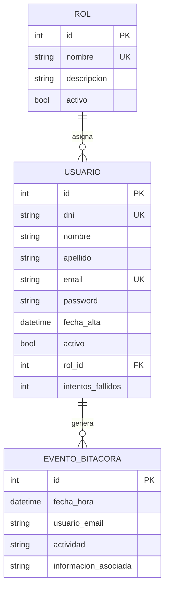

### 7.2 Normalización

El modelo de datos cumple con:
- **Primera Forma Normal (1FN)**: Todos los atributos contienen valores atómicos
- **Segunda Forma Normal (2FN)**: Todos los atributos no clave dependen completamente de la clave primaria
- **Tercera Forma Normal (3FN)**: No hay dependencias transitivas entre atributos no clave

### 7.3 Descripción de Entidades

#### ROL
**Propósito:** Almacenar los roles disponibles en el sistema

| Atributo | Tipo | Restáricción | Descripción |
|:---|:---|:---|:---|
| id | int | PK, AI | Identificador único del rol |
| nombre | varchar(100) | UK, NOT NULL | Nombre del rol (único) |
| Descripción | varchar(500) | | Descripción de responsabilidades |
| activo | bit | NOT NULL | estado del rol (1=activo, 0=inactivo) |

#### USUARIO
**Propósito:** Almacenar la información de usuarios del sistema

| Atributo | Tipo | Restáricción | Descripción |
|:---|:---|:---|:---|
| id | int | PK, AI | Identificador único del usuario |
| dni | int | UK, NOT NULL | Documento de identidad (único) |
| nombre | varchar(50) | NOT NULL | Nombre del usuario |
| apellido | varchar(50) | NOT NULL | Apellido del usuario |
| email | varchar(100) | UK, NOT NULL | Correo electrónico (único) |
| password | varchar(256) | NOT NULL | Contraseña encriptada (hash) |
| fecha_alta | datetime | NOT NULL | Fecha y hora de registro |
| activo | bit | NOT NULL | estado de la cuenta (1=activo, 0=inactivo) |
| rol_id | int | FK, NOT NULL | Referencias a ROL.id |
| intentos_fallidos | int | NOT NULL | Contador de intentos fallidos de login |

#### EVENTO_BITACORA
**Propósito:** Registrar todas las operaciones realizadas en el sistema para Auditoría

| Atributo | Tipo | Restáricción | Descripción |
|:---|:---|:---|:---|
| id | int | PK, AI | Identificador único del evento |
| fecha_hora | datetime | NOT NULL | timestamp del evento (UTC) |
| usuario_email | varchar(100) | NOT NULL | Email del usuario que generó el evento |
| actividad | varchar(50) | NOT NULL | Tipo de actividad (LOGIN, ALTA_USUARIO, MODIFICACION, ELIMINACION, etc.) |
| informacion_asociada | varchar(500) | | Detalles adicionales del evento |

### 7.4 Relaciones

| Relación | Modalidad | Cardinalidad | Descripción |
|:---|:---|:---|:---|
| ROL → USUARIO | 1 | N | Un rol puede tener muchos usuarios |
| USUARIO → EVENTO_BITACORA | 1 | N | Un usuario puede generar múltiples eventos |

### 7.5 Integridad Referencial

- **Restáricción:** ON DELETE RestáRICT en USUARIO.rol_id → ROL.id (No se puede eliminar un rol si tiene usuarios asignados)
- **Restáricción:** ON DELETE CASCADE en EVENTO_BITACORA.usuario_email → USUARIO.email (Si se elimina un usuario, se eliminan sus eventos asociados)

---

# T00. DOCUMENTOS DE ASPECTOS TÉCNICOS

# T01. ARQUITECTURA BASE

## T01.1 Objetivo

Documentar, diseñar e implementar la arquitectura base del sistema de Gestión de usuarios y Auditoría, asegurando:

- Una estructura en capas que promueva separación de responsabilidades
- Patrones de diseño que faciliten mantenibilidad y extensibilidad
- Criterios de POO que aseguren código de calidad
- Esquema de persistencia normalizado y eficiente
- Navegación intuitiva en la interfaz de usuario
- Trazabilidad completa de operaciones mediante Auditoría integrada

---

## T01.2 Descripción Detallada de Funcionamiento

### 2.1 Arquitectura en Capas

El sistema implementa una arquitectura de **4 capas principales** más capas transversales:

```
┌──────────────────────────────────────────────────────┐
│  UI (Presentación)                                   │
│  - Formularios MDI para múltiples ventanas           │
│  - User Controls reutilizables                       │
│  - Gestión de eventos de usuario                     │
└──────────────────────┬───────────────────────────────┘
                       │ Depende de
┌──────────────────────▼───────────────────────────────┐
│  BLL (lógica de Negocio)                             │
│  - Validaciones exhaustivas                          │
│  - Reglas de negocio                                 │
│  - Patrón Observer para Auditoría                    │
│  - Orquestáación de operaciones                       │
└──────────────────────┬───────────────────────────────┘
                       │ Depende de
┌──────────────────────▼───────────────────────────────┐
│  DAL (Acceso a Datos)                                │
│  - Operaciones CRUD                                  │
│  - Conexión a BD                                     │
│  - Singletons para instancia única                   │
└──────────────────────┬───────────────────────────────┘
                       │ Depende de
┌──────────────────────▼───────────────────────────────┐
│  MPP (Mapeadores)                                    │
│  - Mapeo de DataRows a Entidades (BE)                │
│  - Lógica de descifrado AES para lectura             │
└──────────────────────┬───────────────────────────────┘
                       │ Accede a
┌──────────────────────▼───────────────────────────────┐
│  BD (Base de Datos)                                  │
│  - Tablas relacionales                               │
│  - Integridad referencial                            │
│  - Índices para optimización                         │
└──────────────────────────────────────────────────────┘

Capas Transversales:
├─ BE (Entidades): Modelos de datos ubicados en capa compartida
├─ Servicios: Utilidades (Encriptación, Validaciones)
└─ Excepciones: Manejo centralizado de errores
```

### 2.2 Flujo de una Operación Típica: Login de Usuario

```
1. Usuario ingresa credenciales en UI (Login form)
   ↓
2. UI valida entrada básica (campos no vacíos)
   ↓
3. UI invoca UsuarioBLL.Login(email, password)
   ↓
4. BLL valida email y contraseña:
   - Verifica formato de email
   - Invoca Encriptador.VerificarHash() para contraseña
   - Verifica intentos fallidos (bloqueo si > 5)
   ↓
5. Si credenciales válidas:
   - BLL invoca UsuarioDAL.ObtenerPorEmail()
   - DAL ejecuta query a BD
   - BD retorna Usuario
   - DAL retorna Usuario a BLL
   ↓
6. BLL notifica observadores mediante IObservado
   - Invoca BitacoraBLL (IObserver).Actualizar()
   - BitacoraBLL crea EventoBitacora
   - BitacoraBLL invoca BitacoraDAL.Insertar()
   - BitacoraDAL guarda en BD
   ↓
7. BLL retorna Usuario a UI
   ↓
8. UI abre FormPrincipal con menú según rol
```

### 2.3 Patrones de Diseño Aplicados

| Patrón | Ubicación | Implementación | Beneficio |
|:---|:---|:---|:---|
| **Observer** | BLL/BitacoraBLL | UsuarioBLL implementa IObservado, BitacoraBLL implementa IObserver | Desacoplamiento de Auditoría del flujo de negocio |
| **Singleton** | DAL | UsuarioDAL, RolDAL, BitacoraDAL con instancia única | Gestión de conexiones y recursos |
| **Repository** | DAL | Encapsulación de lógica de acceso a datos | Abstracción del almacenamiento |
| **DTO/Entity** | BE | Clases Usuario, Rol, EventoBitacora | Transferencia de datos entre capas |
| **Facade** | BLL | BLL proporciona interfaz unificada | Simplificación de uso desde UI |
| **Template Method** | BLL | Validaciones comunes reutilizables | Reutilización de lógica de validación |

### 2.4 Esquema de Persistencia

#### Consulta de Datos (Read Operation)

```
1. UI solicita dato a BLL
2. BLL aplica reglas de negocio/validaciones
3. BLL invoca DAL (ej: ObtenerPorID)
4. DAL construye query SQL
5. DAL abre conexión a BD
6. DAL ejecuta query
7. DAL mapea resultados a entidades
8. DAL retorna entidades a BLL
9. BLL retorna a UI
```

#### Actualización de Datos (Write Operation)

```
1. UI solicita operación a BLL (ej: Alta, Modificación, Baja)
2. BLL valida datos exhaustivamente
3. BLL invoca Encriptador si es necesario
4. BLL invoca DAL.Guardar() o DAL.Eliminar()
5. DAL construye comando SQL (INSERT/UPDATE/DELETE)
6. DAL abre transacción
7. DAL ejecuta comando
8. DAL invoca Auditoría mediante patrón Observer
9. BitacoraBLL crea evento
10. BitacoraDAL registra evento en BD
11. DAL confirma transacción (COMMIT)
12. DAL retorna resultado a BLL
13. BLL retorna confirmación a UI
```

### 2.5 Gestión de Sesión

- La sesión se mantiene en memoria en UI
- Al logout, se limpia la sesión y se registra evento en Bitácora
- Al cierre de aplicación, se valida integridad de BD (T08 - Futuro)

---

## T01.3 Diagrama de Componentes

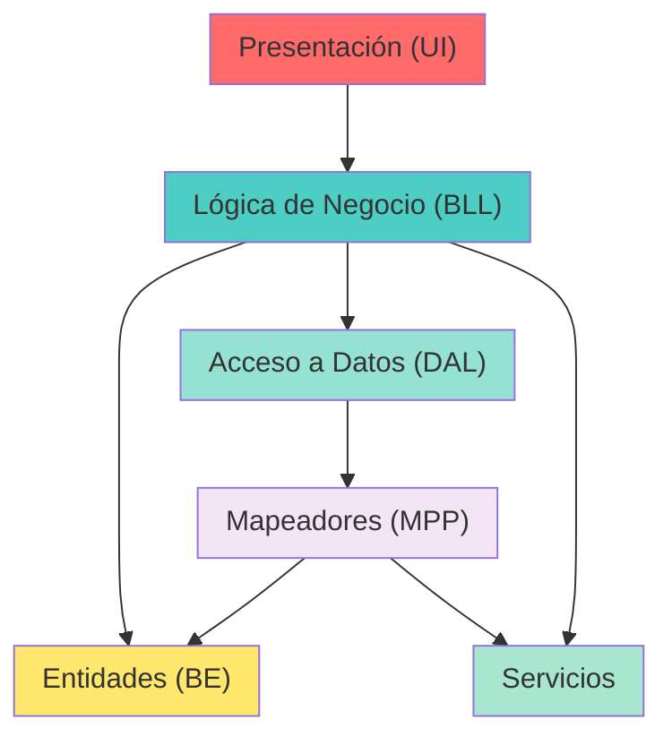

---

## T01.4 Esquema de Persistencia (DER)


---

## T01.5 Mapa de Navegación

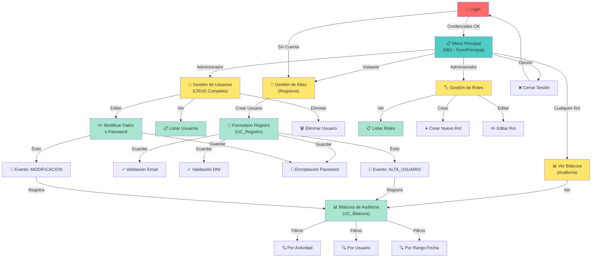

### Códigos de Navegación

| Código | Nombre | Descripción | Acceso |
|:---|:---|:---|:---|
| **L001** | Login | Formulario de autenticación | Todos |
| **P001** | FormPrincipal | Menú principal MDI | Autenticados |
| **U001** | Gestión de Altas | Registro de nuevos usuarios | Visitantes |
| **U002** | Gestión de Usuarios | ABM completo de usuarios | Administradores |
| **R001** | Gestión de Roles | Administración de roles | Administradores |
| **A001** | Bitácora de Auditoría | Visualización de eventos | Todos los autenticados |

---

## T01.6 Criterios de Programación Orientada a Objetos

### 6.1 Cohesión

**Definición:** Grado en que los elementos de una clase están relacionados entre sí.

**Implementación:**

- **UsuarioBLL**: Contiene SOLO operaciones relacionadas con usuarios
  - Registrar nuevos usuarios
  - Autenticar usuarios
  - Modificar datos de usuario
  - Eliminar usuarios
  - Validación de email y contraseña

- **BitacoraBLL**: Responsabilidad ÚNICA de registrar eventos (Single Responsibility Principle)
  - Crear evento
  - Guardar evento
  - Notificar observadores

- **Persona/Usuario**: Herencia bien definida
  - Persona: Clase abstracta con atributos comunes
  - Usuario: Extiende Persona con propiedades específicas

- **EventoBitacora**: Encapsula datos de Auditoría sin comportamiento mixto

**Ventajas:**
- Código más mantenible y comprensible
- Cambios en una responsabilidad no afectan otras
- Facilita testáing de componentes aislados

### 6.2 Acoplamiento

**Definición:** Grado de dependencia entre componentes.

**Implementación - Bajo Acoplamiento mediante Interfaces:**

```csharp
// ✅ BIEN: BLL depende de interfaz, no de implementación
public class UsuarioBLL : IGestor<Usuario>, IObservado
{
    private IObserver _BitacoraBLL; // Depende de interfaz

    public void Registrar(Usuario usuario, string password)
    {
        // lógica de registro
        NotificarObservadores(evento);
    }

    public void NotificarObservadores(EventoBitacora evento)
    {
        foreach(var obs in observadores)
            obs.Actualizar(evento); // Se comunica por interfaz
    }
}

// ✅ BIEN: UI depende de BLL, no de DAL
public partial class Login : Form
{
    private UsuarioBLL usuarioBLL = new UsuarioBLL();

    private void BtnLogin_Click(object sender, EventArgs e)
    {
        usuarioBLL.Login(email, password);
    }
}

// ❌ MAL - No hacer esto:
public class UsuarioBLL
{
    private UsuarioDAL usuarioDAL = new UsuarioDAL(); // Fuerte acoplamiento
}
```

**estárategias Aplicadas:**
- **Inyección de Dependencias Implícita**: Singletons en DAL permiten cambiar implementación
- **Pattern Observer**: Desacopla BitacoraBLL de UsuarioBLL
- **Interfaces**: Abstractas permiten múltiples implementaciones

**Ventajas:**
- Fácil reemplazar implementaciones
- Testáing simplificado con mocks
- Código flexible y mantenible

### 6.3 Reusabilidad

**Definición:** Capacidad de usar componentes en diferentes contextos.

**Implementación:**

- **Interfaces Genéricas**: 
```csharp
public interface IGestor<T>
{
    List<T> ListarTodos();
    T ObtenerPorID(int id);
    void Guardar(T objeto);
    void Eliminar(int id);
}
// Implementada por: UsuarioBLL, RolBLL, y futuras entidades
```

- **Interfaces Generales**: 
```csharp
public interface IObserver { void Actualizar(EventoBitacora evento); }
public interface IObservado { void Notificar(EventoBitacora evento); }
// Aplicables a múltiples clases sin cambios
```

- **Servicios Reutilizables**: 
```csharp
public class Encriptador
{
    public static string GenerarHash(string texto) { }
    public static bool VerificarHash(string texto, string hash) { }
}
// Usado por: UsuarioBLL, modificación de contraseña, etc.
```

- **User Controls**: 
```
UC_Registro y UC_Bitacora pueden integrarse en múltiples formularios
sin modificar su código interno
```

**Beneficios:**
- Reduce código duplicado
- Facilita mantenimiento centralizado
- Mejora productividad de desarrollo

### 6.4 Extensibilidad

**Definición:** Facilidad para agregar nuevas funcionalidades sin modificar código existente.

**Implementación:**

- **Herencia Extensible**: 
```csharp
// Ejemplo futuro: Fácil agregar nuevo tipo de Persona
public abstract class Persona { /* atributos comunes */ }
public class Usuario : Persona { /* específico de Usuario */ }
public class Empleado : Persona { /* específico de Empleado */ } // Futuro
```

- **Interfaces para Nuevas Entidades**: 
```csharp
// Nueva entidad puede implementar fácilmente sin cambiar código
public class ProductoBLL : IGestor<Producto>
{
    // Implementar los 4 métodos de IGestor
}
```

- **Observer Pattern**: 
```csharp
// Nuevos observadores pueden suscribirse sin modificar UsuarioBLL
public class EmailNotificador : IObserver
{
    public void Actualizar(EventoBitacora evento) { /* enviar email */ }
}
// Registrar en UsuarioBLL.AgregarObservador(new EmailNotificador())
```

- **Roles Flexibles**: 
```csharp
// Nuevos roles en BD sin cambios de código
// Sistema automáticamente asigna permisos basados en rol_id
```

**Ventajas:**
- Agregar funcionalidad sin riesgo de regresión
- Código existente permanece estáable
- Fácil evolucionar el sistema

### 6.5 Encapsulamiento

**Definición:** Ocultamiento de detalles internos de implementación.

**Implementación:**

- **Propiedades Privadas**: 
```csharp
public class UsuarioBLL
{
    private List<IObserver> observadores; // Privado
    private int intentosFallidos; // Privado

    public void AgregarObservador(IObserver obs) // Público
    {
        observadores.Add(obs);
    }
}
```

- **Métodos Privados**: 
```csharp
public class UsuarioBLL
{
    public bool Login(string email, string password)
    {
        if (EsEmailValido(email)) // Privado, uso interno
        {
            // lógica
        }
    }

    private bool EsEmailValido(string email)
    {
        return Regex.IsMatch(email, @"^[^@\s]+@[^@\s]+\.[^@\s]+$");
    }
}
```

- **Singletons en DAL**: 
```csharp
public class UsuarioDAL
{
    private static UsuarioDAL instancia; // Privado

    public static UsuarioDAL ObtenerInstancia() // Acceso controlado
    {
        if (instancia == null)
            instancia = new UsuarioDAL();
        return instancia;
    }

    private UsuarioDAL() { } // Constructor privado
}
```

- **Abstracciones**: 
```csharp
public abstract class Persona
{
    // Encapsula comportamiento común
    protected string nombre;
    protected string apellido;

    public abstract bool Validar();
}
```

**Beneficios:**
- Controla cómo se accede a datos internos
- Facilita cambios de implementación sin afectar código externo
- Mejora seguridad y robustez

---

## T01.7 Validaciones y Seguridad

### Validaciones Implementadas

- **Email**: Formato válido, unicidad en base de datos
- **DNI**: Numérico, único en base de datos
- **Contraseña**: Mínimo 6 caracteres, encriptación con hash SHA256
- **Datos obligatorios**: Campos requeridos validados antes de persistencia

### Seguridad

- **Encriptación de Contraseñas**: Hash SHA256 no reversible
- **Bloqueo por Intentos**: 5 intentos fallidos = bloqueo de cuenta
- **Auditoría Completa**: Todos los login (exitosos y fallidos) registrados
- **Manejo de Excepciones**: Excepciones específicas para distintos escenarios

---

## T01.8 Pruebas Unitarias

### estárategia de Testáing

Las pruebas unitarias se enfocan en validar:

| Componente | Casos de Prueba | Propósito |
|:---|:---|:---|
| **UsuarioBLL - Login** | Credenciales válidas | Validar autenticación exitosa |
| | Credenciales inválidas | Validar rechazo de acceso |
| | Email no existe | Validar manejo de usuario inexistente |
| | Bloqueo por intentos | Validar seguridad anti-fuerza bruta |
| **UsuarioBLL - Registro** | Datos válidos | Validar creación de nuevo usuario |
| | Email duplicado | Validar prevención de duplicados |
| | Email inválido | Validar rechazo de formato incorrecto |
| | DNI duplicado | Validar unicidad de DNI |
| **BitacoraBLL** | Notificación de evento | Validar pattern Observer |
| | Registro en BD | Validar persistencia de eventos |
| **Encriptador** | Hash de contraseña | Validar encriptación correcta |
| | Verificación de hash | Validar coincidencia de hash |

### Cobertura de Pruebas

- **Capa BLL**: 80-90% (lógica crítica de negocio)
- **Capa DAL**: 60-70% (integración con BD)
- **Capa BE**: 100% (validaciones y datos)
- **Servicios**: 90%+ (utilidades críticas)

---

## T01.9 Conclusiones de Arquitectura Base

La arquitectura implementada cumple exitosamente con:

✅ **Arquitectura en 4 capas bien definidas** separando Presentación, lógica, acceso a datos y persistencia

✅ **Aplicación de patrones de diseño** (Observer para Auditoría, Singleton para DAL, Repository para acceso)

✅ **Criterios de POO**: 
   - Cohesión: Clases con responsabilidad única
   - Acoplamiento: Bajo mediante interfaces
   - Reusabilidad: Interfaces genéricas y servicios compartidos
   - Extensibilidad: Fácil agregar nuevas funcionalidades
   - Encapsulamiento: Ocultamiento de detalles internos

✅ **Seguridad integral**: Encriptación, validaciones exhaustivas, Auditoría completa

✅ **Mantenibilidad**: Código modular, testeable y documentado

✅ **Escalabilidad**: Fácil extender con nuevas funcionalidades sin modificar código existente

✅ **.NET Framework 4.7.2**: Cumplimiento con requisitos de ambiente

---

# T02. GESTIÓN DE LOGIN/LOGOUT Y Gestión DE USUARIOS

## T02.1 Objetivo

Documentar, diseñar e implementar el subsistema de autenticación, Gestión de sesiones y control de acceso que permite:

- **Autenticación Segura**: Verificación de identidad del usuario mediante credenciales (email y contraseña)
- **Gestión de Sesiones**: Mantener y controlar la sesión activa del usuario durante su permanencia en el sistema
- **Control de Acceso**: Validar permisos basados en el rol asignado al usuario
- **Política de Seguridad**: Implementar bloqueos por intentos fallidos y timeout de sesión
- **Trazabilidad de Acceso**: Registrar todos los eventos de login, logout y cambios de permisos en la Bitácora
- **Arranque/Apagado Seguro**: Garantizar integridad del sistema en startup, operación y shutdown
- **Patrón Singleton**: Asegurar instancia única y centralizada de sesión en toda la aplicación

---

## T02.2 Descripción Detallada de Funcionamiento

### 2.1 Política de Login

#### Flujo de Autenticación

```
INICIO: Usuario accede a la aplicación
   ↓
[Pantalla Login]
   ├─ Usuario ingresa EMAIL y PASSWORD
   ├─ Validar formato email (RFC 5322 simplificado)
   ├─ SI formato inválido → Mostrar error "Email inválido" → Reintentar
   │
   ↓ (Formato válido)

[Verificación en BD]
   ├─ SessionManager (Singleton) invoca UsuarioBLL.AutenticarUsuario(email, password)
   ├─ UsuarioBLL busca usuario por email en BD
   │
   ├─ SI usuario NO existe:
   │  └─ Registrar evento: INTENTO_LOGIN_FALLIDO (usuario inexistente)
   │  └─ Mostrar: "Email o contraseña incorrectos"
   │  └─ SALIR (no revelar si email existe)
   │
   ├─ SI usuario existe:
   │  ├─ Verificar si está activo (activo = 1)
   │  ├─ SI usuario inactivo:
   │  │  └─ Registrar evento: INTENTO_LOGIN_FALLIDO (usuario inactivo)
   │  │  └─ Mostrar: "Usuario inactivo. Contacte al administrador"
   │  │  └─ SALIR
   │  │
   │  ├─ SI usuario activo:
   │  │  ├─ Verificar contador intentos_fallidos
   │  │  ├─ SI intentos_fallidos >= 5:
   │  │  │  └─ Registrar evento: USUARIO_BLOQUEADO
   │  │  │  └─ Mostrar: "Cuenta bloqueada por exceso de intentos. Contacte al administrador"
   │  │  │  └─ Lanzar excepción: UsuarioBloqueadoException
   │  │  │  └─ SALIR
   │  │  │
   │  │  ├─ SI intentos_fallidos < 5:
   │  │  │  ├─ Obtener hash contraseña de BD
   │  │  │  ├─ Encriptador.VerificarHash(password, hash_en_bd)
   │  │  │  │
   │  │  │  ├─ SI hash NO coincide:
   │  │  │  │  ├─ Incrementar intentos_fallidos en 1
   │  │  │  │  ├─ Si intentos_fallidos = 5 → Bloquear usuario
   │  │  │  │  ├─ Actualizar usuario en BD
   │  │  │  │  ├─ Registrar evento: INTENTO_LOGIN_FALLIDO (contraseña incorrecta)
   │  │  │  │  ├─ Mostrar: "Email o contraseña incorrectos"
   │  │  │  │  └─ SALIR (reintentar)
   │  │  │  │
   │  │  │  ├─ SI hash SÍ coincide:
   │  │  │  │  ├─ ÉXITO: Credenciales válidas
   │  │  │  │  ├─ Resetear intentos_fallidos = 0
   │  │  │  │  ├─ Actualizar usuario en BD
   │  │  │  │  ├─ SessionManager.CrearSesion(usuario)
   │  │  │  │  │  ├─ Crear objeto Sesion con:
   │  │  │  │  │  │  ├─ UsuarioID
   │  │  │  │  │  │  ├─ Email
   │  │  │  │  │  │  ├─ Rol
   │  │  │  │  │  │  ├─ FechaLogin (DateTime.UtcNow)
   │  │  │  │  │  │  ├─ FechaUúltimaActividad (DateTime.UtcNow)
   │  │  │  │  │  │  ├─ Activa = true
   │  │  │  │  │  │  └─ TimeoutMinutos = 30 (configurable)
   │  │  │  │  │  └─ Registrar evento: LOGIN_EXITOSO
   │  │  │  │  └─ Mostrar: FormPrincipal con menú según Rol
   │  │  │  │  └─ SUCESO: Sesión iniciada
   │  │  │  └─
   │  │  │
   │  │  └─
   │  │
   │  └─
   │
   └─
```

#### Políticas de Seguridad Login

- **Intentos Fallidos**: Máximo 5 intentos antes de bloqueo temporal
- **Bloqueo**: Requiere intervención de administrador para desbloquear
- **Timeout Inactividad**: Sesión cierra si no hay actividad por 30 minutos
- **Validación Email**: Formato RFC 5322 simplificado
- **Validación Contraseña**: Se compara hash SHA256 con valor en BD
- **Auditoría**: Cada intento registrado (exitoso o fallido) en EVENTO_BITACORA

### 2.2 Política de Logout

#### Flujo de Cierre de Sesión

```
INICIO: Usuario solicita logout
   ↓
[Confirmación Usuario]
   ├─ FormPrincipal muestra diálogo: "¿Desea cerrar sesión?"
   ├─ SI usuario cancela → Continuar en aplicación → SALIR
   │
   ├─ SI usuario confirma:
   │  ├─ SessionManager.CerrarSesion()
   │  │  ├─ Obtener sesión activa
   │  │  ├─ Cambiar Sesion.Activa = false
   │  │  ├─ establecer FechaCierre = DateTime.UtcNow
   │  │  ├─ Registrar evento: LOGOUT (mediante BitacoraBLL)
   │  │  │
   │  │  ├─ Limpiar recursos:
   │  │  │  ├─ Cerrar formularios abiertos (FormPrincipal, UC, etc.)
   │  │  │  ├─ Liberar conexiones a BD
   │  │  │  ├─ Vaciar variables de sesión en memoria
   │  │  │  └─ Liberar referencias a Usuario y Rol
   │  │  │
   │  │  ├─ Retornar a Login
   │  │  └─ Mostrar: "Sesión cerrada exitosamente"
   │  │
   │  └─ SUCESO: Sesión cerrada
   │
   └─
```

#### Políticas de Seguridad Logout

- **Confirmación Explícita**: Usuario debe confirmar cierre de sesión
- **Limpieza Completa**: Liberación total de recursos y memoria
- **Auditoría**: Registro de logout con timestamp
- **Bloqueo de Acceso**: Tras logout, usuario no puede usar datos de sesión anterior
- **Retorno a Login**: Siempre volver al formulario de inicio sin retener datos

### 2.3 Procesos de Arranque del Sistema (Startup)

```
ANTES DE MOSTRAR LOGIN:
   ↓
[1. Inicializar Conexión a BD]
   ├─ Verificar conectividad a SQL Server
   ├─ SI falla conectividad:
   │  └─ Mostrar error crítico y cerrar aplicación
   │
   ├─ SI conectividad OK:
   │  └─ Continuar
   ↓
[2. Validar Integridad de BD - FUTURO T08]
   ├─ Ejecutar proceso de dígitos verificadores
   ├─ SI integridad OK:
   │  └─ Continuar
   │
   ├─ SI integridad FALLA:
   │  ├─ Registrar evento crítico
   │  ├─ Mostrar alerta al administrador
   │  └─ Permitir acceso solo a Admin para mantenimiento
   ↓
[3. Inicializar Singleton: SessionManager]
   ├─ Crear instancia única de SessionManager
   ├─ Inicializar colección de sesiones activas
   ├─ Inicializar temporizador de timeout (verificar cada minuto)
   │
   ├─ Registrar evento: SISTEMA_INICIADO
   │
   └─ Mostrar Formulario: Login
```

#### Acciones de Startup

- **Verificar BD**: Conectividad y disponibilidad
- **Validar Integridad**: Verificación de checksums (T08 futuro)
- **Inicializar SessionManager**: Singleton listo para gestionar sesiones
- **Registrar en Auditoría**: Evento SISTEMA_INICIADO
- **Mostrar Login**: Pantalla de autenticación

### 2.4 Procesos de Apagado del Sistema (Shutdown)

```
USUARIO CIERRA APLICACIÓN:
   ↓
[1. Verificar Sesiones Activas]
   ├─ SessionManager.ObtenerSesionesActivas()
   ├─ SI hay sesiones activas:
   │  ├─ Registrar evento: LOGOUT para cada sesión
   │  ├─ Cerrar cada sesión (limpiar recursos)
   │  └─ Continuar
   │
   ├─ SI no hay sesiones activas:
   │  └─ Continuar
   ↓
[2. Guardar estado de la Aplicación]
   ├─ Cerrar conexiones de BD
   ├─ Flushing de buffer de Bitácora (garantizar que todos los eventos estén guardados)
   │
   ├─ Registrar evento: SISTEMA_APAGADO (con timestamp)
   │
   ├─ Liberar recursos del Singleton SessionManager
   │
   └─ Cerrar aplicación
```

#### Acciones de Shutdown

- **Cerrar Sesiones**: Logout de todos los usuarios activos
- **Persistir Auditoría**: Asegurar que todos los eventos se guardaron
- **Liberar Conexiones**: Cierre limpio de conexión a BD
- **Registrar Apagado**: Evento SISTEMA_APAGADO en Bitácora
- **Liberar Singleton**: Destruir instancia de SessionManager

### 2.5 Gestión de Permisos en Sesión

```
DURANTE LA SESIÓN ACTIVA:
   ↓
[Verificación de Permisos en Cada Operación]
   ├─ Usuario intenta acceder a funcionalidad
   ├─ UI obtiene SessionManager.SesionActual
   ├─ SessionManager.ValidarPermiso(usuario.rol_id, funcionalidad)
   │
   ├─ PermissionValidator consulta rol en BD
   ├─ PermissionValidator obtiene lista de permisos para rol
   │
   ├─ SI usuario tiene permiso:
   │  ├─ Mostrar UI/funcionalidad
   │  ├─ Registrar evento: ACCESO_PERMITIDO (en BD)
   │  └─ Continuar operación
   │
   ├─ SI usuario NO tiene permiso:
   │  ├─ Deshabilitar UI/funcionalidad
   │  ├─ Mostrar mensaje: "No tiene permisos para acceder a este recurso"
   │  ├─ Registrar evento: ACCESO_DENEGADO (en BD)
   │  └─ Retornar sin ejecutar operación
   │
   └─
```

### 2.6 Timeout de Sesión por Inactividad

```
CONTROL DE INACTIVIDAD:
   ↓
[Timer: Ejecuta cada 1 minuto]
   ├─ SessionManager verifica todas las sesiones activas
   ├─ Para cada Sesion:
   │  ├─ Calcular: MinutosInactividad = (DateTime.UtcNow - FechaUúltimaActividad).TotalMinutes
   │  │
   │  ├─ SI MinutosInactividad >= TimeoutMinutos (30):
   │  │  ├─ Marcar sesión como expirada
   │  │  ├─ Registrar evento: SESION_EXPIRADA_TIMEOUT
   │  │  ├─ Notificar UI del usuario
   │  │  ├─ Redirigir a Login
   │  │  └─ Mostrar: "Su sesión ha expirado por inactividad"
   │  │
   │  ├─ SI MinutosInactividad < TimeoutMinutos:
   │  │  ├─ Sesión continúa activa
   │  │  └─ FechaUúltimaActividad se actualiza con cada acción del usuario
   │  │
   │  └─
   │
   └─ Continuar monitoring cada minuto
```

---

## T02.3 Diagrama de Clases

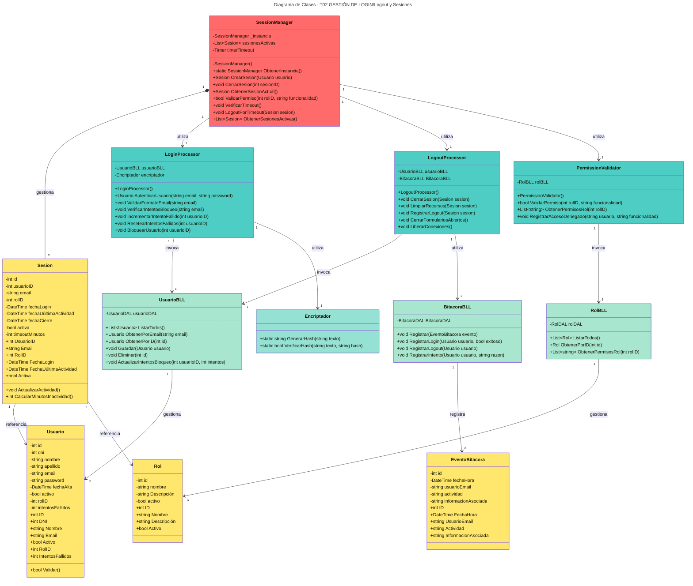

### Descripción de Responsabilidades por Clase

#### Clase: SessionManager (Singleton)
**Responsabilidades - Hacer:**
- Crear y mantener sesiones activas de usuarios
- Validar permisos durante operaciones
- Monitorear timeout de inactividad
- Cerrar sesiones expiradas
- gestionar ciclo de vida de sesión

**Responsabilidades - Conocer:**
- Sesión activa actual del usuario
- Todas las sesiones activas en el sistema
- Permisos asociados a cada rol
- Tiempo de timeout configurado
- estado de cada sesión (activa/expirada)

#### Clase: Sesion (BE)
**Responsabilidades - Hacer:**
- Actualizar marca de úúltima actividad
- Calcular minutos de inactividad

**Responsabilidades - Conocer:**
- Datos del usuario en sesión
- Rol del usuario
- Tiempos de login y úúltimas actividades
- estado de actividad

#### Clase: LoginProcessor (BLL)
**Responsabilidades - Hacer:**
- Autenticar usuario con email y password
- Validar formato de email
- Verificar bloqueos por intentos
- Incrementar/resetear contadores de intentos fallidos

**Responsabilidades - Conocer:**
- Reglas de validación de email
- Política de intentos fallidos
- Usuarios y sus credenciales encriptadas

#### Clase: LogoutProcessor (BLL)
**Responsabilidades - Hacer:**
- Cerrar sesión del usuario
- Liberar recursos asignados a la sesión
- Registrar logout en Bitácora
- Cerrar formularios abiertos
- Limpiar memoria

**Responsabilidades - Conocer:**
- estado de la sesión a cerrar
- Recursos asociados a la sesión
- Formularios abiertos

#### Clase: PermissionValidator (BLL)
**Responsabilidades - Hacer:**
- Validar si usuario tiene permiso para funcionalidad
- Registrar accesos denegados en Auditoría

**Responsabilidades - Conocer:**
- Permisos por rol
- Funcionalidades del sistema y sus permisos asociados

---

## T02.4 Diagrama de Secuencia - Flujo de Login

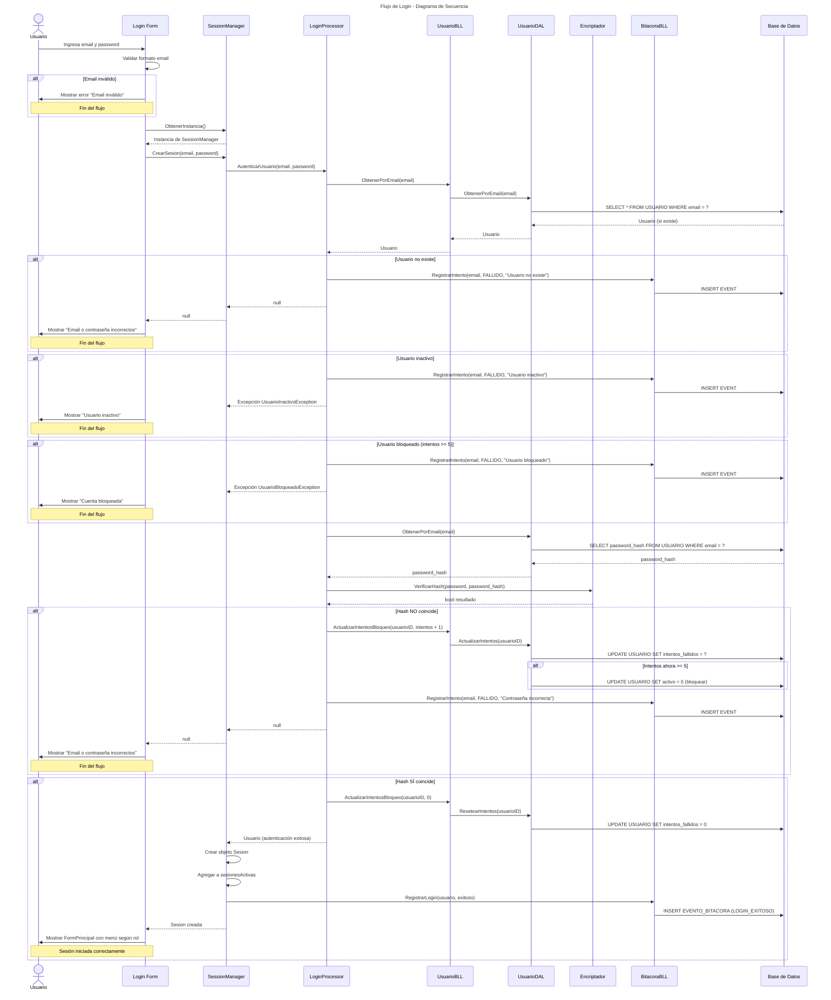

---

## T02.5 Diagrama de Secuencia - Flujo de Logout

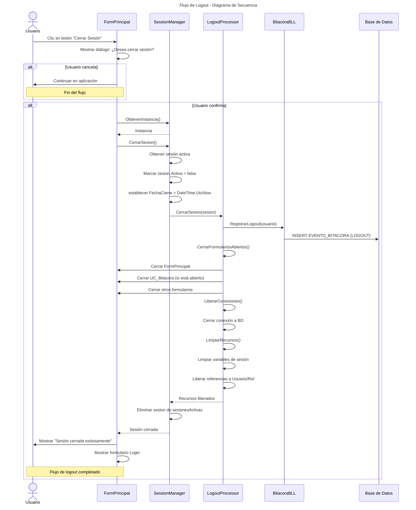

---

## T02.6 Diseño de Algoritmos

### 6.1 Algoritmo: Patrón Singleton para SessionManager

```
ALGORITMO: ObtenerInstancia_SessionManager

ENTRADA: ninguna

VARIABLES:
    _instancia: referencia static a SessionManager
    _lockObject: objeto de sincronización para thread-safety

PROCESO:

    1. SI _instancia es NULL ENTONCES

        2. SINCRONIZAR(_lockObject)  // Thread-safety

            3. SI _instancia es NULL ENTONCES

                4. _instancia := NUEVA SessionManager()
                5. INICIALIZAR:
                   - sesionesActivas := LIST vacia
                   - timerTimeout := NUEVO Timer()
                   - timerTimeout.Intervalo := 60000 (1 minuto)
                   - timerTimeout.Evento_Tick := VerificarTimeout()
                   - timerTimeout.Iniciar()

            6. FIN SI

        7. FIN SINCRONIZAR

    8. FIN SI

    9. RETORNAR _instancia

COMPLEJIDAD:
    - Tiempo: O(1)
    - Espacio: O(1)
    - Thread-safe: SÍ (doble verificación)
```

### 6.2 Algoritmo: Creación de Sesión

```
ALGORITMO: CrearSesion

ENTRADA:
    usuario: Usuario (entidad autenticada)

VARIABLES:
    sesion: Sesion
    sesionID: int

PROCESO:

    1. VALIDAR usuario != NULL
        SINO: LANZAR EXCEPCIÓN "Usuario nulo"

    2. sesionID := GenerarID_Unico()

    3. sesion := NUEVA Sesion()
    4. ASIGNAR:
        - sesion.ID := sesionID
        - sesion.UsuarioID := usuario.ID
        - sesion.Email := usuario.Email
        - sesion.RolID := usuario.RolID
        - sesion.FechaLogin := DateTime.UtcNow
        - sesion.FechaUúltimaActividad := DateTime.UtcNow
        - sesion.Activa := TRUE
        - sesion.TimeoutMinutos := 30

    5. sesionesActivas.AGREGAR(sesion)

    6. BitacoraBLL.RegistrarLogin(usuario, exitoso=TRUE)

    7. RETORNAR sesion

COMPLEJIDAD:
    - Tiempo: O(1)
    - Espacio: O(1)
```

### 6.3 Algoritmo: Verificar Hash de Contraseña

```
ALGORITMO: VerificarHash (Encriptador)

ENTRADA:
    passwordIngresado: string (contraseña en texto plano)
    hashAlmacenado: string (hash SHA256 de BD)

VARIABLES:
    hashIngresado: string

PROCESO:

    1. VALIDAR passwordIngresado != NULL y != VACIO
        SINO: RETORNAR FALSE

    2. VALIDAR hashAlmacenado != NULL y != VACIO
        SINO: RETORNAR FALSE

    3. hashIngresado := SHA256(passwordIngresado)

    4. SI hashIngresado == hashAlmacenado ENTONCES
        RETORNAR TRUE
    SINO
        RETORNAR FALSE
    FIN SI

COMPLEJIDAD:
    - Tiempo: O(n) donde n es longitud del password
    - Espacio: O(1)
    - Nota: Se utiliza String.Equals() con igualdad constante para prevenir timing attacks
```

### 6.4 Algoritmo: Validar Permiso

```
ALGORITMO: ValidarPermiso

ENTRADA:
    rolID: int
    funcionalidad: string

VARIABLES:
    permisosRol: List<string>
    tienePermiso: bool

PROCESO:

    1. VALIDAR rolID > 0
        SINO: RETORNAR FALSE

    2. VALIDAR funcionalidad != NULL y != VACIO
        SINO: RETORNAR FALSE

    3. permisosRol := RolBLL.ObtenerPermisosRol(rolID)

    4. SI permisosRol es NULL o VACIO ENTONCES
        RETORNAR FALSE
    FIN SI

    5. tienePermiso := FALSE

    6. PARA CADA permiso EN permisosRol HACER
        SI permiso.ToUpper() == funcionalidad.ToUpper() ENTONCES
            tienePermiso := TRUE
            SALIR DEL BUCLE
        FIN SI
    FIN PARA

    7. SI tienePermiso == FALSE ENTONCES
        PermissionValidator.RegistrarAccesoDenegado(usuario, funcionalidad)
    FIN SI

    8. RETORNAR tienePermiso

COMPLEJIDAD:
    - Tiempo: O(n) donde n es cantidad de permisos del rol
    - Espacio: O(n) para almacenar permisosRol
```

### 6.5 Algoritmo: Verificar Timeout de Inactividad

```
ALGORITMO: VerificarTimeout (Timer cada 1 minuto)

ENTRADA: ninguna

VARIABLES:
    sesionActual: Sesion
    minutosInactividad: double
    sesionesAExpirar: List<Sesion>

PROCESO:

    1. CREAR sesionesAExpirar := LIST vacia

    2. PARA CADA sesionActual EN sesionesActivas HACER

        3. SI sesionActual.Activa == FALSE ENTONCES
            CONTINUAR (siguiente sesión)
        FIN SI

        4. minutosInactividad := (DateTime.UtcNow - sesionActual.FechaUúltimaActividad).TotalMinutes

        5. SI minutosInactividad >= sesionActual.TimeoutMinutos ENTONCES

            6. sesionesAExpirar.AGREGAR(sesionActual)

        FIN SI

    FIN PARA

    7. PARA CADA sesion EN sesionesAExpirar HACER

        8. BitacoraBLL.RegistrarLogout(sesion, razon="TIMEOUT_INACTIVIDAD")

        9. LogoutProcessor.CerrarSesion(sesion)

        10. sesionesActivas.ELIMINAR(sesion)

        11. NotificarUIUsuario(sesion.UsuarioID, "Sesión expirada por inactividad")

    FIN PARA

COMPLEJIDAD:
    - Tiempo: O(n) donde n es cantidad de sesiones activas
    - Espacio: O(m) donde m es cantidad de sesiones expiradas
```

---

## T02.7 Actualización de DER (Diagrama Entidad-Relación)

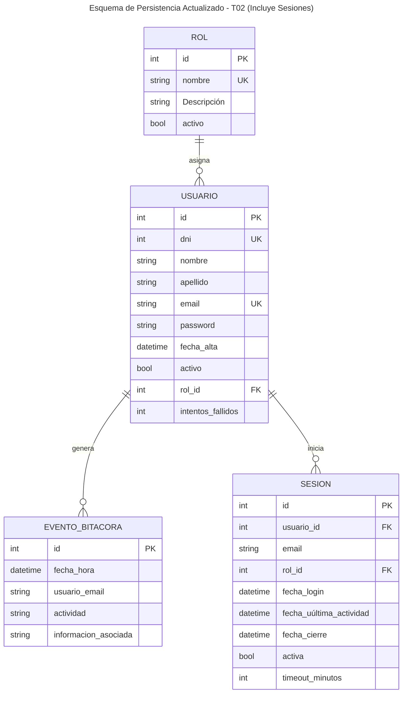

### Descripción de Nueva Entidad: SESION

**Propósito:** Almacenar registro de sesiones activas y cerradas para Auditoría y análisis de acceso

| Atributo | Tipo | Restáricción | Descripción |
|:---|:---|:---|:---|
| id | int | PK, AI | Identificador único de la sesión |
| usuario_id | int | FK, NOT NULL | Referencias a USUARIO.id |
| email | varchar(100) | NOT NULL | Email del usuario (desnormalizado para Auditoría) |
| rol_id | int | FK, NOT NULL | Referencias a ROL.id (desnormalizado para Auditoría) |
| fecha_login | datetime | NOT NULL | Fecha y hora cuando sesión se inició |
| fecha_uúltima_actividad | datetime | NOT NULL | Úúltima acción del usuario en estáa sesión |
| fecha_cierre | datetime | | Fecha y hora cuando sesión cerró (NULL si activa) |
| activa | bit | NOT NULL | estado de sesión (1=activa, 0=cerrada) |
| timeout_minutos | int | NOT NULL | Duración timeout configurada (por defecto 30) |

### Relaciones Actualizadas

| Relación | Modalidad | Cardinalidad | Descripción |
|:---|:---|:---|:---|
| ROL → USUARIO | 1 | N | Un rol puede tener muchos usuarios |
| USUARIO → SESION | 1 | N | Un usuario puede tener múltiples sesiones (histórico) |
| USUARIO → EVENTO_BITACORA | 1 | N | Un usuario puede generar múltiples eventos |

---

## T02.8 Excepciones Específicas de T02

Se definen las siguientes excepciones en la capa BE (Excepciones):

```csharp
/// <summary>
/// Excepción lanzada cuando usuario ha superado intentos fallidos de login
/// </summary>
public class UsuarioBloqueadoException : ApplicationException
{
    public string Email { get; set; }
    public int IntentosFallidos { get; set; }

    public UsuarioBloqueadoException(string email, int intentos) 
        : base($"Usuario {email} ha sido bloqueado tras {intentos} intentos fallidos")
    {
        Email = email;
        IntentosFallidos = intentos;
    }
}

/// <summary>
/// Excepción lanzada cuando usuario existe pero está inactivo
/// </summary>
public class UsuarioInactivoException : ApplicationException
{
    public string Email { get; set; }

    public UsuarioInactivoException(string email) 
        : base($"Usuario {email} está inactivo")
    {
        Email = email;
    }
}

/// <summary>
/// Excepción lanzada cuando credenciales son inválidas
/// </summary>
public class CredencialesInvalidasException : ApplicationException
{
    public CredencialesInvalidasException() 
        : base("Email o contraseña incorrectos")
    {
    }
}

/// <summary>
/// Excepción lanzada cuando no hay sesión activa
/// </summary>
public class SesionNoActivaException : ApplicationException
{
    public SesionNoActivaException() 
        : base("No hay sesión activa. Debe iniciar sesión primero")
    {
    }
}

/// <summary>
/// Excepción lanzada cuando usuario no tiene permiso para operación
/// </summary>
public class PermisoDenegadoException : ApplicationException
{
    public string Usuario { get; set; }
    public string Funcionalidad { get; set; }

    public PermisoDenegadoException(string usuario, string funcionalidad) 
        : base($"Usuario {usuario} no tiene permiso para {funcionalidad}")
    {
        Usuario = usuario;
        Funcionalidad = funcionalidad;
    }
}
```

---

## T02.9 Resumen de Políticas de Seguridad - T02

| Política | Descripción | Implementación |
|:---|:---|:---|
| **Intentos Fallidos** | Máximo 5 intentos antes de bloqueo | Contador en tabla USUARIO.intentos_fallidos |
| **Bloqueo Temporal** | Usuario bloqueado requiere Admin para desbloquear | Campo USUARIO.activo = 0 |
| **Timeout Sesión** | 30 minutos de inactividad = cierre automático | Timer en SessionManager cada 1 min |
| **Validación Email** | RFC 5322 simplificado antes de buscar en BD | Regex en LoginProcessor |
| **Encriptación Password** | SHA256 hash no reversible | Encriptador.VerificarHash() |
| **Auditoría Completa** | Todos eventos registrados en EVENTO_BITACORA | BitacoraBLL notificado de cada acción |
| **Permisos por Rol** | Usuario solo accede según su ROL.id | PermissionValidator en cada operación |
| **Cleanup Logout** | Liberación total de recursos tras cierre | LogoutProcessor.LimpiarRecursos() |
| **Singleton SessionManager** | Instancia única en toda la aplicación | Patrón Singleton con thread-safety |

---

## T02.10 Conclusiones de T02 - Login/Logout

La implementación de T02 cumple exitosamente con:

✅ **Autenticación Segura**: Validación de credenciales con hash SHA256 y manejo de intentos fallidos

✅ **Gestión de Sesiones**: SessionManager Singleton mantiene control centralizado y único

✅ **Control de Acceso**: Validación de permisos por rol en cada operación crítica

✅ **Políticas Robustas**: 
   - Bloqueo por 5 intentos
   - Timeout por inactividad (30 min)
   - Logout limpio con liberación de recursos

✅ **Auditoría Integrada**: Todos los eventos de login/logout registrados en Bitácora

✅ **Seguridad en Startup/Shutdown**: Inicialización y cierre controlados del sistema

✅ **Patrón Singleton**: SessionManager implementado con thread-safety para instancia única

✅ **Diagrama y Secuencia**: Modelado completo del flujo de autenticación

✅ **Excepciones Específicas**: Manejo de errores diferenciado por tipo de fallo

✅ **DER Actualizado**: Nueva entidad SESION para histórico de accesos

---

## Anexos

### Anexo A: Referencias de Diagramas

- Los diagramas de componentes, entidad-relación y navegación se encuentran embebidos directamente en las secciones **T01.3**, **T01.4/G07.1** y **T01.5** respectivamente, utilizando el estándar Mermaid para garantizar una única fuente de verdad.

### Anexo B: estructura de Proyectos en Solución

```
Trabajo Practico Final/
├── BE/                    # Business Entities - Entidades de negocio
├── BLL/                   # Business Logic Layer - lógica de negocio
├── DAL/                   # Data Access Layer - Acceso a datos
├── UI/                    # User Interface - Presentación
├── Servicios/             # Servicios compartidos (Encriptación, etc.)
└── Documentacion/         # Documentación del sistema (incluye diagramas Mermaid)
```

### Anexo C: Consideraciones para Futuras Iteraciones

**T03. Gestión de Encriptado**
- Implementar encriptación asimétrica para datos sensibles

**T04. Gestión de Perfiles de Usuario**
- Implementar permisos compuestos con patrón Composite

**T05. Gestión de Múltiples Idiomas**
- Implementar Observer para cambio dinámico de idiomas

**T06. Gestión de Bitácora y Control de Cambios**
- Extender Bitácora con trazabilidad de cambios en campos

**T07. Gestión de Backup**
- Implementar copia de seguridad automática y restáauración

**T08. Gestión de Dígitos Verificadores**
- Implementar validación de integridad de datos

---

*Documento: Carpeta de Documentación - Trabajo Práctico Final UAI*  
*Versión: 1.0*  
*Fecha: 2026-04-30*  
*Alumno: Perazzo, Martin Alejo y Conde Nicolas*  
*Docente: Silva Juan Ignacio y Avila Javier Ramón*
\
---

# T03. GESTIÓN DE ENCRIPTADO

## T03.1 Objetivo

El objetivo de la Gestión de encriptado es proteger los datos sensibles almacenados en el sistema mediante algoritmos criptográficos robustos, asegurando tanto la irreversibilidad de credenciales como la confidencialidad recuperable de datos personales.

- **Irreversibilidad**: Garantizar que las contraseñas no puedan ser obtenidas en texto plano (Hashing).
- **Confidencialidad**: Proteger datos sensibles como el DNI permitiendo su recuperación solo por personal autorizado (Encriptación Simétrica).

## T03.2 Descripción Detallada de Funcionamiento

El sistema implementa dos mecanismos principales de protección de datos:

### 2.1 Hashing de Contraseñas (SHA256)
Para las contraseñas, se utiliza el algoritmo **SHA256**. Es un método unidireccional que genera una huella digital única.
1. El sistema recibe la contraseña en texto plano.
2. Se genera el hash SHA256.
3. El hash resultante se almacena en el campo `Password` de la tabla `USUARIO`.
4. Durante el login, se aplica el mismo proceso al input del usuario y se comparan los hashes.

### 2.2 Encriptación Simétrica de DNIs (AES-256)
Para los DNIs, se utiliza **AES (Advanced Encryption Standard)** con una clave de 256 bits y un vector de inicialización (IV).
1. **Cifrado**: Al guardar un usuario, el DNI en texto plano se cifra y se almacena como una cadena Base64.
2. **Descifrado**: Al listar o consultar usuarios, el sistema recupera la cadena Base64 y la descifra utilizando la misma clave e IV para mostrar el DNI original.

## T03.3 Diagrama de Clases (Análisis y Diseño)

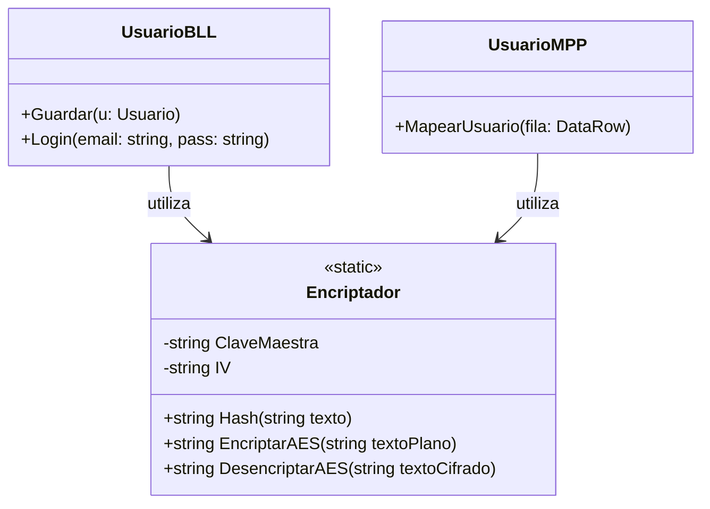

## T03.4 Modelo de Datos (DER Técnico)

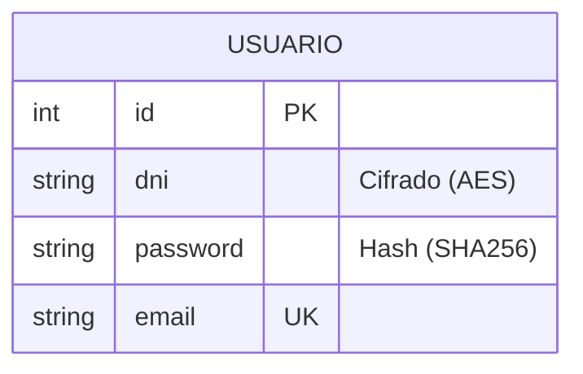

## T03.5 Diagramas de Secuencia (Implementación)

### Secuencia: Cifrado de DNI en Registro
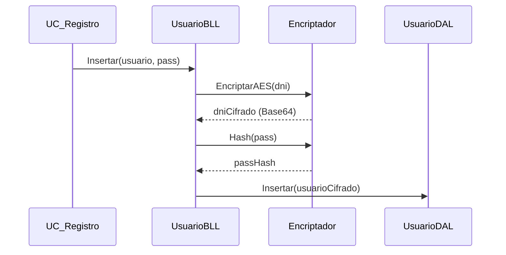

### Secuencia: Descifrado de DNI en Consulta
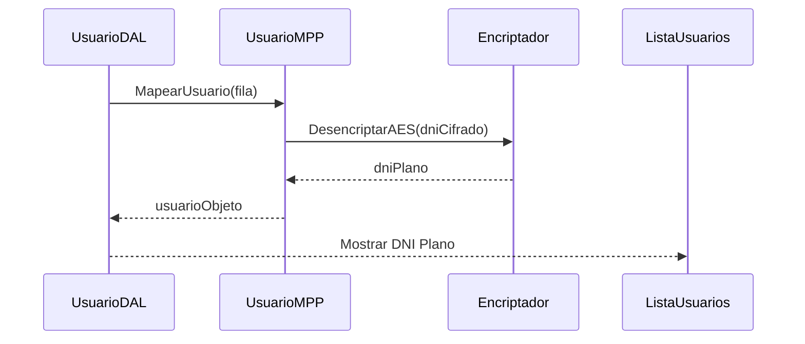

## T03.6 Diseño de los Algoritmos

### Algoritmo 1: Generación de Hash (SHA256)
```text
Entrada: texto (string)
Salida: hash (string hexadecimal)

1. Crear instancia de SHA256.
2. Convertir texto de entrada a array de bytes (UTF8).
3. Computar Hash del array de bytes.
4. Convertir cada byte resultante a su representación hexadecimal (x2).
5. Concatenar y retornar el string resultante (64 caracteres).
```

### Algoritmo 2: Encriptación Simétrica (AES-256)
```text
Entrada: textoPlano (string), ClaveMaestra, IV
Salida: textoCifrado (string Base64)

1. Crear instancia de algoritmo AES.
2. Configurar Clave y IV (32 bytes y 16 bytes respectivamente).
3. Crear un Encryptor con la Clave e IV configurados.
4. Crear un MemoryStream para almacenar el flujo cifrado.
5. Utilizar un CryptoStream para transformar el texto plano mediante el Encryptor.
6. Escribir el texto plano en el CryptoStream.
7. Convertir el contenido del MemoryStream a una cadena Base64.
8. Retornar la cadena Base64.
```

---

## T03.5 Diseño de Algoritmos

### 5.1 Algoritmo: Generación de Hash SHA256

```
ALGORITMO: GenerarHashSHA256

ENTRADA: texto (string)
SALIDA: hashHexadecimal (string)

PROCESO:
    1. Convertir texto a bytes (UTF-8)
    2. Instanciar proveedor SHA256
    3. Computar hash de los bytes
    4. Convertir cada byte del hash a su rePresentación hexadecimal (2 caracteres)
    5. Concatenar resultados
    6. RETORNAR cadena resultante
```

---

# T06a. Gestión DE Bitácora

## T06a.1 Objetivo

El objetivo del subsistema de Bitácora es registrar de manera automática e íntegra todas las operaciones realizadas por los usuarios dentro del sistema. Esto permite garantizar la trazabilidad de las actividades, facilitar procesos de Auditoría y mejorar la seguridad general de la aplicación mediante el seguimiento de acciones críticas.

## T06a.2 Descripción Detallada de Funcionamiento

### 2.1 Registro Automático mediante Patrón Observer

El sistema utiliza el **Patrón de Diseño Observer** para desacoplar la lógica de negocio de la Auditoría. Las clases de negocio (como UsuarioBLL) actúan como sujetos observados (IObservado), notificando a la BitacoraBLL (IObserver) ante cada evento relevante.


Cada registro de Bitácora incluye los siguientes datos mínimos:
- **Fecha y Hora**: timestamp exacto del suceso.
- **Usuario**: Identificador (email) del usuario que ejecutó la acción.
- **Actividad**: Categoría de la acción (LOGIN, ALTA_USUARIO, MODIFICACION, BLOQUEO, etc.).
- **Información Asociada**: Detalle descriptivo del evento.


### 2.2 Arquitectura del Subsistema

El subsistema sigue la arquitectura en 4 capas del proyecto:
- **BE (Business Entities)**: Provee la clase EventoBitacora para el transporte de datos.
- **BLL (Business Logic Layer)**: BitacoraBLL (Singleton) gestiona la lógica de Auditoría y coordina con la DAL.
- **DAL (Data Access Layer)**: BitacoraDAL gestiona la persistencia en SQL Server mediante procedimientos almacenados.
- **UI (Presentación)**: El User Control UC_Bitacora ofrece la interfaz para que los administradores consulten los registros.

### 2.3 Búsqueda Avanzada y Filtrado Combinado

La interfaz de Bitácora permite realizar Búsquedas combinadas utilizando los siguientes criterios:
1. **Rango de Fechas**: Filtrado por fecha desde y hasta.
2. **Usuario**: Búsqueda por email de usuario.
3. **Actividad**: Selección de tipo de actividad mediante un control desplegable.

El procedimiento almacenado en la base de datos está� dise�ado para manejar par�metros opcionales, permitiendo combinar estos filtros de manera flexible (ej: ver todos los 'BLOQUEOS' del 'Usuario X' en la '�última Semana').\
\
## T06a.3 Diagrama de Clases (Bitácora)

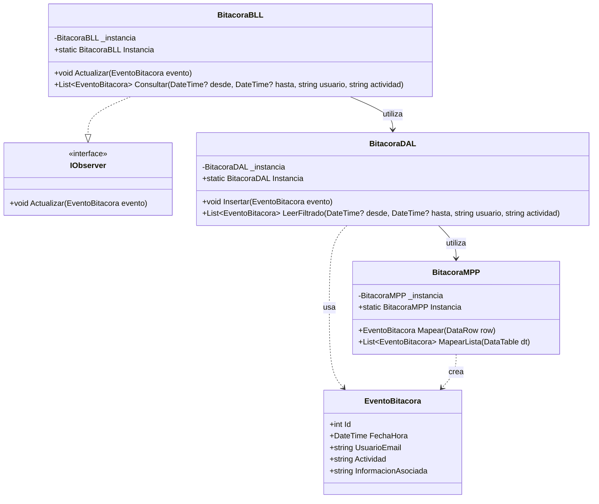

## T06a.4 Diagrama de Secuencia (Registro de Evento)

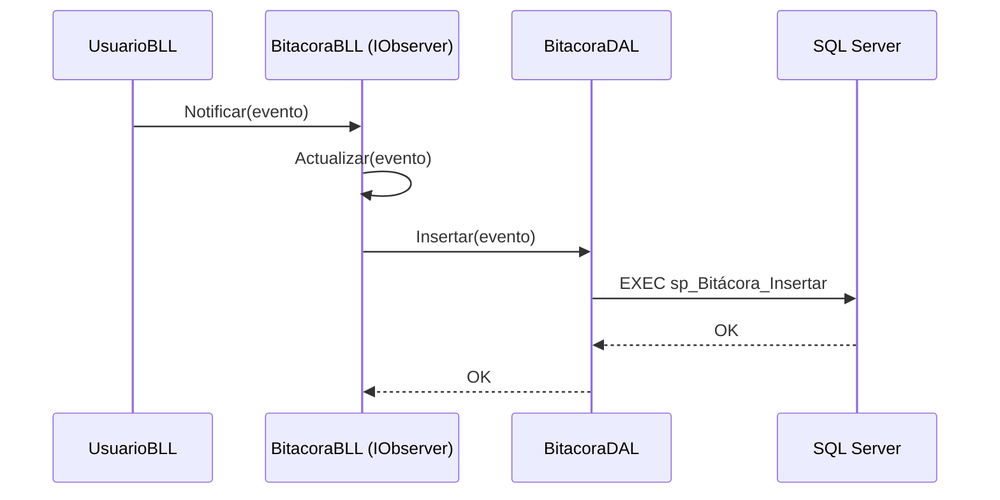
## T06a.5 Diagrama de Secuencia (Consulta con Filtros)

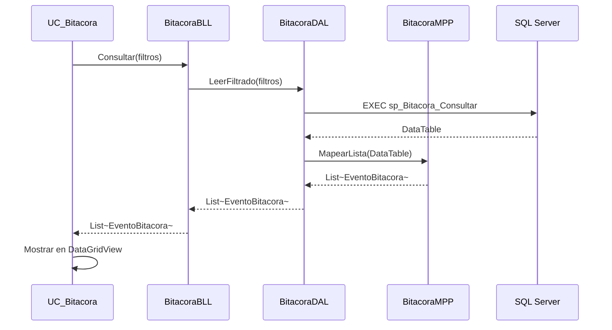
## T06a.6 Modelo de Datos (DER - Bitácora)

```mermaid
erDiagram
    USUARIO ||--o{ EVENTO_BITACORA : \genera\

    EVENTO_BITACORA {
        int id PK
        datetime fecha_hora
        string usuario_email FK
        string actividad
        string informacion_asociada
    }
```\


