# Descripcion Global del Producto y Arquitectura del Sistema

## G01. Proposito

El sistema de informacion para la perfumeria tiene como proposito resolver las siguientes problematicas organizacionales y operativas:

1. **Control de Inventario y Trazabilidad:** Eliminar discrepancias de stock y garantizar la trazabilidad de origen y lote de cada fragancia comercializada, mitigando riesgos de falsificacion o perdidas.
2. **Gobernanza Financiera en Compras:** Formalizar el circuito de compras a multiples proveedores, estableciendo una instancia de aprobacion obligatoria por el equipo de contabilidad previa a la emision de ordenes de compra.
3. **Fidelizacion de Clientes:** Implementar un programa de membresia en el punto de venta para captar datos de contacto y preferencias olfativas, aplicando descuentos inmediatos y habilitando campanas de marketing segmentadas.
4. **Optimizacion en la Seleccion de Proveedores:** Dotar a la administracion de una matriz multicriterio para evaluar proveedores segun prestigio, precio y antiguedad en el mercado, asignando compras prioritarias por producto para maximizar rentabilidad y evitar perdidas.
5. **Seguridad y Auditoria:** Garantizar la integridad transaccional, trazabilidad de operaciones criticas y control de accesos basado en perfiles.

---

## G02. Descripcion Funcional del Producto y Alcance

### 2.1 Gestiones Organizacionales Involucradas

1. **Gestion de Aprovisionamiento, Stock y Trazabilidad:**
   - Emision de solicitudes de cotizacion a multiples proveedores.
   - Registro de ordenes de compra preliminares sujetas a aprobacion contable.
   - Recepcion fisica de mercaderia, control de calidad y registro de lotes/certificados de origen.
   - Control de inventario y archivo historico de compras.

2. **Gestion de Ventas y Fidelizacion:**
   - Atencion y despacho de productos en mostrador.
   - Identificacion y registro de clientes en el programa de membresia.
   - Aplicacion automatica de beneficios y descuentos vigentes.
   - Consolidacion de datos y preferencias para campanas de marketing directo.

3. **Gestion de Evaluacion Estrategica de Proveedores:**
   - Relevamiento de propuestas comerciales, antecedentes y certificaciones.
   - Evaluacion ponderada de tres dimensiones: Prestigio, Precio/Impacto Contable y Antiguedad.
   - Asignacion de proveedor preferencial por producto o familia olfativa.

4. **Gestion de Seguridad, Auditoria y Soporte:**
   - Autenticacion y autorizacion mediante control de acceso basado en roles.
   - Registro inmutable de eventos en bitacora.
   - Verificacion de integridad de datos mediante digitos verificadores.

### 2.2 Limites del Alcance

- **Incluido:** Gestion integral de stock, trazabilidad por lote, compras con flujo contable, ventas con membresia, evaluacion de proveedores, auditoria y seguridad en 4 capas.
- **Excluido:** Integracion con pasarelas de pago bancarias externas en tiempo real (se asienta comprobante de cobro), comercio electronico web B2C (alcance limitado a terminal de punto de venta y gestion administrativa) y fabricacion directa de fragancias.

### 2.3 Diagramas de Casos de Uso por Proceso de Negocio

A continuación se presentan los **Diagramas de Casos de Uso divididos individualmente por Proceso de Negocio**, delimitando con precisión sus actores participantes, límites funcionales y relaciones formales de inclusión (`<<include>>`) y extensión (`<<extend>>`).

---

#### 2.3.1 Proceso 1: Aprovisionamiento, Control de Inventario y Trazabilidad

> **Propósito:** Gestionar el abastecimiento de fragancias garantizando el control físico de stock, la trazabilidad de origen de cada lote, la previa aprobación financiera por Contabilidad y el registro de pasivos.

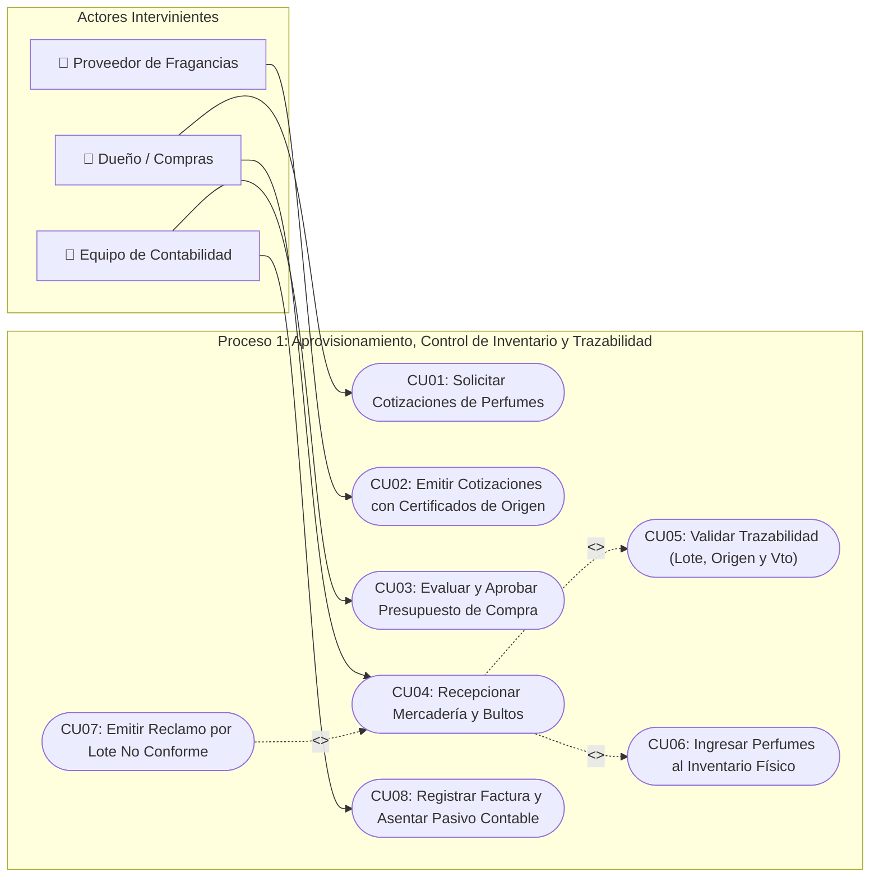

---

#### 2.3.2 Proceso 2: Venta en Mostrador y Fidelización de Clientes

> **Propósito:** Concretar ventas en mostrador incentivando la adhesión a membresías, aplicando descuentos y utilizando las preferencias para campañas de marketing.

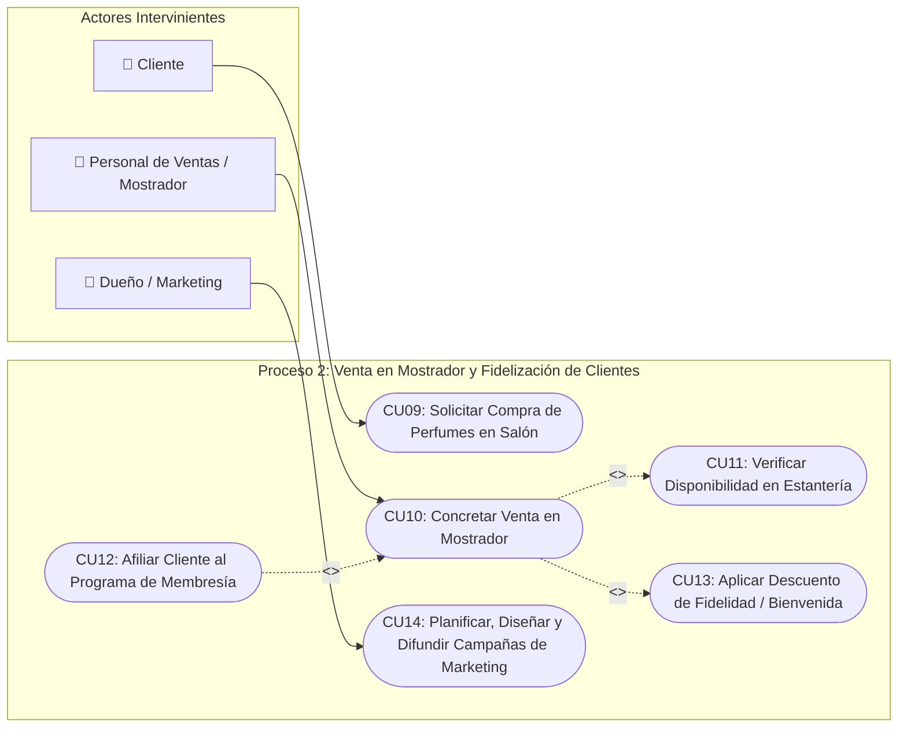

---

#### 2.3.3 Proceso 3: Evaluación y Selección Estratégica de Proveedores

> **Propósito:** Calificar y categorizar formalmente a los proveedores según prestigio, precio y antigüedad, asignando proveedores estratégicos por producto para maximizar rentabilidad.

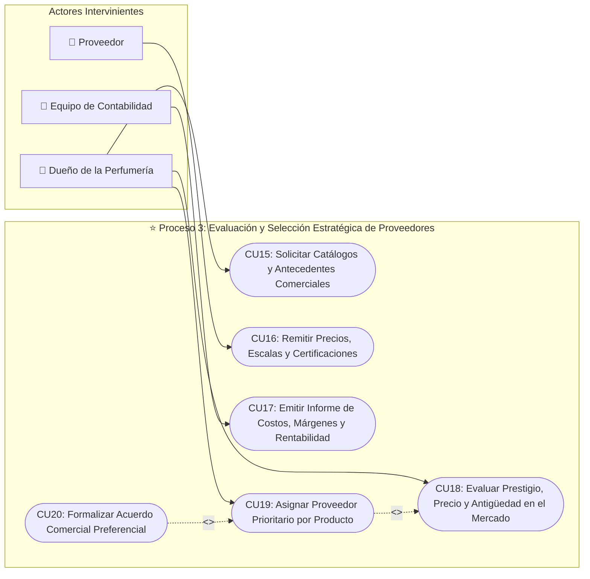

---

#### 2.3.4 Módulo Transversal: Seguridad, Autenticación y Auditoría

> **Propósito:** Proveer autenticación segura, control de acceso basado en roles, cifrado criptográfico y registro de eventos críticos en bitácora.

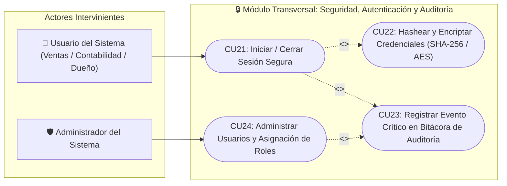

### 2.4 Diagramas de Actividad de Negocio

#### Proceso 1: Aprovisionamiento de Perfumes, Trazabilidad y Aprobacion Contable

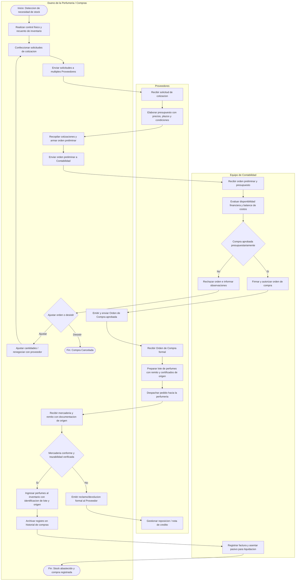

#### Proceso 2: Venta y Fidelizacion de Clientes (Membresia, Descuentos y Campanas)

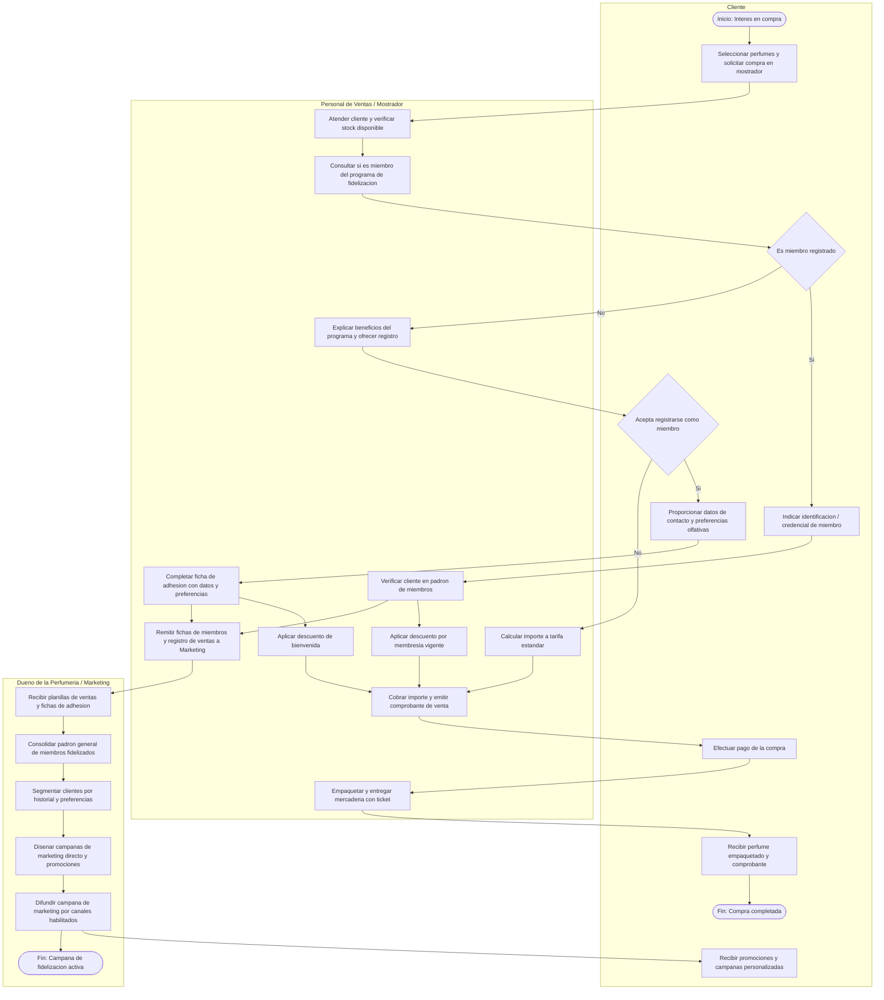

#### Proceso 3: Evaluacion y Seleccion Estrategica de Proveedores por Producto

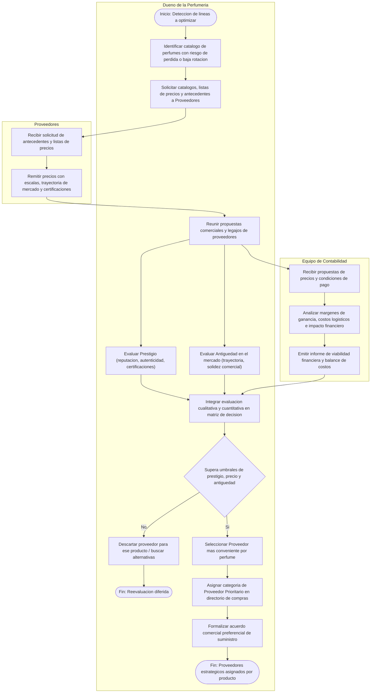

---

### 2.5 Diagramas de Secuencia de Negocio

Los participantes representan personas, areas y terceros de la organizacion. Por ese motivo los diagramas describen intercambios de documentos, decisiones y mercaderia sin introducir componentes del sistema.

#### Secuencia 1: Aprovisionamiento, aprobacion contable y trazabilidad

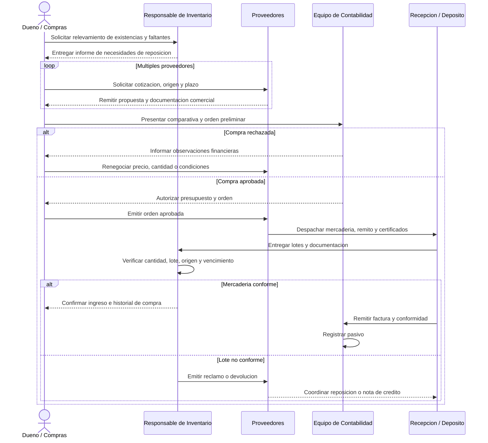

#### Secuencia 2: Venta y fidelizacion de clientes

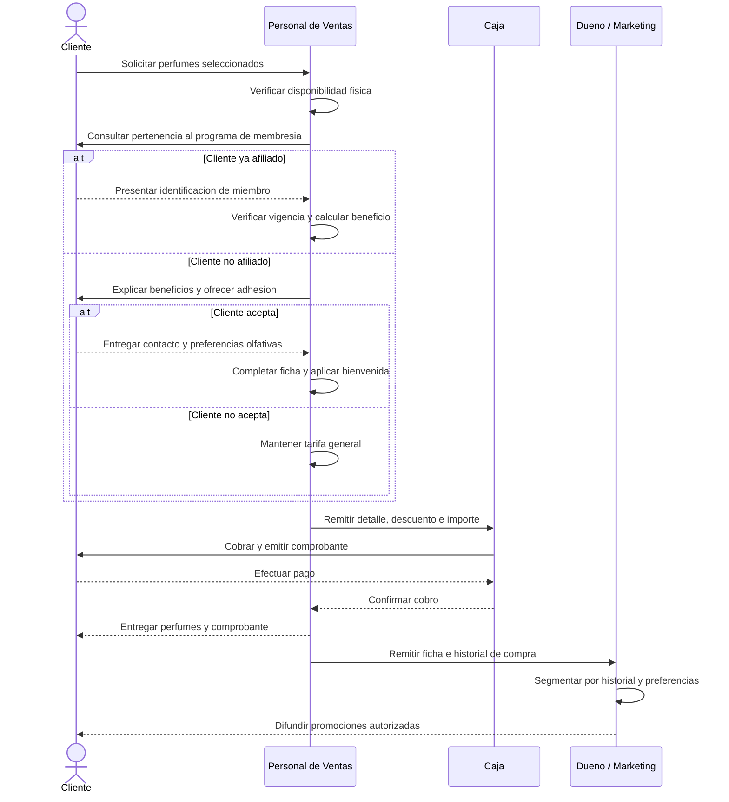

#### Secuencia 3: Evaluacion estrategica de proveedores

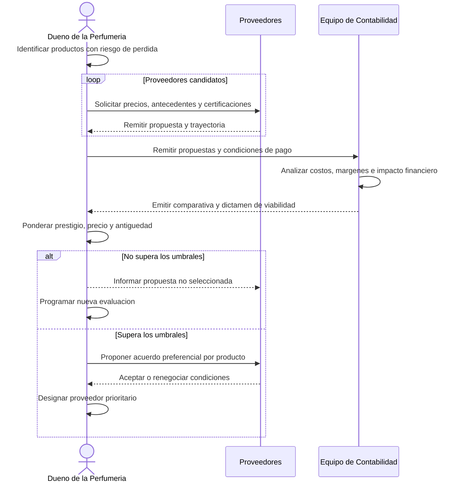

#### Correspondencia con la implementacion de las iteraciones 1 y 2

De acuerdo con el plan de entregas, N01 se disena en la Iteracion 1 y se implementa en la Iteracion 2; N02 se analiza, disena e implementa en la Iteracion 2; N03 queda para la Iteracion 3.

| Actividad de negocio | Operacion implementada |
| :--- | :--- |
| Registrar propuestas de proveedores | `AprovisionamientoBLL.RegistrarCotizacion` |
| Confeccionar la orden preliminar | `AprovisionamientoBLL.CrearOrdenPreliminar` |
| Presentar la comparativa a Contabilidad | `AprovisionamientoBLL.EnviarOrdenARevisionContable` |
| Autorizar o rechazar la compra | `AprovisionamientoBLL.AprobarOrdenCompra` / `RechazarOrdenCompra` |
| Emitir la orden aprobada | `AprovisionamientoBLL.EmitirOrdenAprobada` |
| Recepcionar lotes y actualizar existencias | `AprovisionamientoBLL.RecepcionarMercaderia` |
| Consultar stock y trazabilidad | `InventarioBLL.VerificarStock` / `ObtenerTrazabilidad` |
| Registrar cliente, preferencias y consentimiento | `VentaBLL.RegistrarCliente` |
| Activar membresia y beneficio | `VentaBLL.ActivarMembresia` |
| Registrar venta y egreso FEFO | `VentaBLL.RegistrarVenta` |
| Evaluar y recomendar proveedores | N03: implementacion prevista para la Iteracion 3 |

---

## G03. Planificacion del Proyecto

Plan de entregas reconciliado con el spreadsheet provisto:

| Semana | Iteracion | Hito / Entregable | Objetivos Especificos |
| :--- | :--- | :--- | :--- |
| Entrega 1 | Iteracion 1 | G01-G08 | Descripcion global: proposito, alcance, planificacion, glosario, participantes, requisitos generales, clases por capa y modelo de datos. |
| Entrega 1 | Iteracion 1 | N01 | Analisis y diseno del proceso de aprovisionamiento e inventario, incluidos actividad, casos principales, clases, secuencias y datos. |
| Entrega 2 | Iteracion 2 | N01 | Implementacion de los conceptos disenados en la iteracion anterior. |
| Entrega 2 | Iteracion 2 | N02 | Analisis, diseno e implementacion de venta y fidelizacion. |
| Entrega 2 | Iteracion 2 | A01 | Instalador inicial simple con creacion/restauracion de base, tablas, indices y relaciones. |
| Entrega 3 | Iteracion 3 | N03 | Proceso complejo de valor agregado: evaluacion y recomendacion de proveedores. |

---

## G04. Definiciones, Acronimos y Abreviaciones

### Definiciones

- **Perfume / Fragancia:** Articulo comercializable clasificado por marca, linea, concentracion y familia olfativa.
- **Lote:** Conjunto de unidades de un mismo perfume producidas o adquiridas bajo un codigo unico que determina fecha de elaboracion y partida de origen.
- **Trazabilidad de Origen:** Capacidad de rastrear el historico de adquisicion, proveedor emisor, remito y lote de cada producto ingresado.
- **Membresia de Fidelizacion:** Programa de afiliacion que asocia compras, descuentos acumulados y preferencias de los clientes para acciones de marketing.
- **Proveedor Prioritario:** Calificacion resultante de la ponderacion multicriterio que determina la preferencia de compra para un producto determinado.
- **Digitos Verificadores (DVH/DVV):** Mecanismos criptograficos de control que aseguran la no alteracion de registros en la base de datos.

### Acronimos

- **CUN:** Caso de Uso de Negocio.
- **DER:** Diagrama Entidad-Relacion.
- **MDI:** Multiple Document Interface (Interfaz de Multiples Documentos).
- **POO:** Programacion Orientada a Objetos.
- **RF / RNF:** Requerimiento Funcional / Requerimiento No Funcional.
- **BE:** Business Entities (Capa de Entidades de Negocio).
- **BLL:** Business Logic Layer (Capa de Logica de Negocio).
- **DAL:** Data Access Layer (Capa de Acceso a Datos).
- **MPP:** Mapper / Mapeador de Persistencia.

### Abreviaturas

- **OC:** Orden de Compra.
- **Prov:** Proveedor.
- **Cli:** Cliente.
- **Inv:** Inventario.
- **Reg:** Registro.

---

## G05. Descripcion de las Personas Participantes

### 5.1 Interesados y Participantes Organizacionales

| Nombre / Rol del Participante | Descripcion del Puesto | Responsabilidad en el Proyecto |
| :--- | :--- | :--- |
| **Dueno de la Perfumeria** | Direccion general y administracion comercial | Patrocinador, define politicas de abastecimiento, criterios de seleccion de proveedores y aprueba el alcance. |
| **Responsable de Compras** | Encargado operativo de adquisiciones e inventario | Define requerimientos de stock, recepcion de mercaderia, control de lotes y trazabilidad. |
| **Personal de Ventas / Mostrador** | Atencion directa al cliente en salon | Opera el punto de venta, registra nuevos miembros en el programa de fidelizacion y aplica beneficios. |
| **Equipo de Contabilidad** | Control financiero, costos y balances | Define requerimientos de autorizacion presupuestaria, calculo de margenes y asiento de pasivos. |
| **Analista y Desarrollador** | Equipo tecnico de ingenieria de software | Modela requerimientos, implementa la arquitectura en capas, desarrolla codigo y ejecuta pruebas. |

### 5.2 Matriz Preliminar de Accesos al Sistema

| Rol en Sistema | Modulos con Acceso Permitido | Nivel de Permiso |
| :--- | :--- | :--- |
| **Administrador / Dueno** | Todos los modulos (Compras, Ventas, Evaluacion, Seguridad, Auditoria) | Total (Lectura, Escritura, Configuracion) |
| **Contabilidad** | Aprobacion de OC, Registro de Compras, Informes Financieros, Auditoria | Lectura y Autorizacion Financiera |
| **Compras / Deposito** | Solicitudes de Cotizacion, Recepcion de Stock, Trazabilidad de Lotes | Lectura y Escritura operativa |
| **Vendedor** | Facturacion Mostrador, Alta de Membresias, Catalogo de Productos | Operativo de Venta y Fidelizacion |

---

## G06. Otros Requisitos del Producto y Documentacion

### 6.1 Estandares Aplicables
- **Notacion UML 2.5:** Para diagramas de casos de uso, actividad y clases.
- **Arquitectura en N-Capas (UI, BLL, DAL/MPP, BE, Servicios):** Separacion estricta de responsabilidades y bajo acoplamiento.
- **Normalizacion Relacional:** Modelo de datos estructurado bajo Tercera Forma Normal (3FN).
- **Estandares de Codificacion C# / .NET:** Nomenclatura PascalCase/camelCase y principios SOLID.

### 6.2 Requisitos de Sistema
- **Plataforma Operativa:** Microsoft Windows 10 / 11 o Windows Server 2019+.
- **Framework:** .NET Framework 4.8 o superior.
- **Motor de Persistencia:** Microsoft SQL Server 2017+.

### 6.3 Requisitos de Desempeno
- Tiempo de respuesta en consultas de stock y membresias inferior a 2 segundos bajo carga concurrente de hasta 20 terminales locales.
- Consistencia transaccional ACID garantizada en registros de ventas y recepciones de inventario.

### 6.4 Requisitos de Entorno
- Interfaz grafica de usuario de escritorio basada en contenedores MDI.
- Conexion cifrada contra la base de datos relacional centralizada.

### 6.5 Requisitos de Documentacion
- Manual de usuario final por rol.
- Guia de instalacion, despliegue y configuracion de base de datos.
- Diccionario de datos y documentacion tecnica de arquitectura.

---

## G07. Diagrama de Clases de todos los Modulos Implementados

### 7.1 Capa de Entidades de Negocio (BE) y Servicios

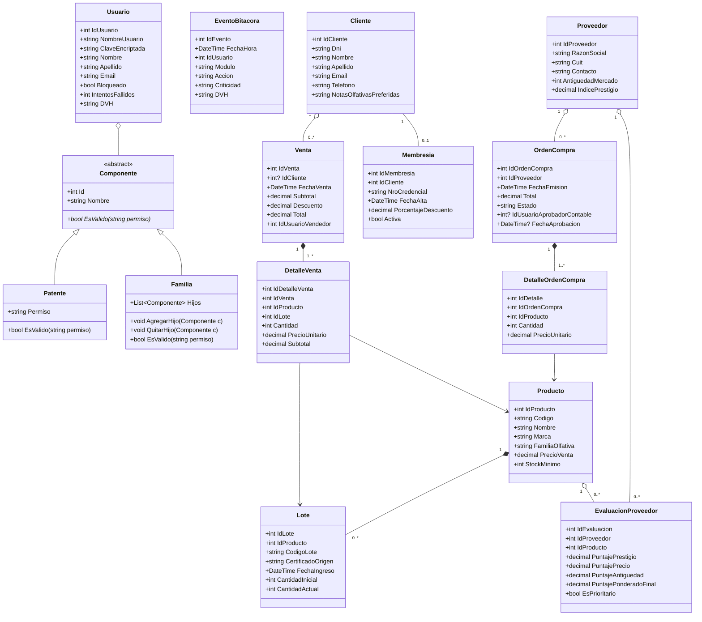

### 7.2 Capa de Logica de Negocio (BLL) y Capa de Persistencia (DAL/MPP)

```mermaid
classDiagram
    class AprovisionamientoBLL {
        +CrearOrdenPreliminar(OrdenCompra oc, List~DetalleOrdenCompra~ detalles) bool
        +AprobarOrdenCompra(int idOC, int idUsuarioContable) bool
        +RechazarOrdenCompra(int idOC, string motivo) bool
        +RecepcionarMercaderia(int idOC, List~Lote~ lotesRecibidos) bool
        +ConsultarHistorialCompras(int? idProveedor) List~OrdenCompra~
    }

    class InventarioBLL {
        +VerificarStock(int idProducto) int
        +RegistrarIngresoLote(Lote lote) bool
        +DescontarStockLote(int idLote, int cantidad) bool
        +ObtenerLotesDisponibles(int idProducto) List~Lote~
    }

    class VentaBLL {
        +RegistrarVenta(Venta venta, List~DetalleVenta~ detalles) bool
        +CalcularImporte(List~DetalleVenta~ detalles, int? idCliente) decimal
    }

    class FidelizacionBLL {
        +RegistrarMiembro(Cliente cliente, decimal porcentajeInicial) Membresia
        +ConsultarMembresia(int idCliente) Membresia
        +SegmentarMiembros(string familiaOlfativa) List~Cliente~
    }

    class EvaluacionProveedorBLL {
        +CalcularConveniencia(int idProveedor, int idProducto, decimal precio) EvaluacionProveedor
        +AsignarProveedorPrioritario(int idProveedor, int idProducto) bool
        +ObtenerMatrizConveniencia(int idProducto) List~EvaluacionProveedor~
    }

    class SeguridadBLL {
        +Autenticar(string usuario, string clave) Usuario
        +TienePermiso(Usuario usuario, string permiso) bool
        +BloquearUsuario(int idUsuario) void
    }

    class BitacoraBLL {
        +RegistrarEvento(EventoBitacora evento) void
        +ConsultarEventos(DateTime desde, DateTime hasta, string modulo) List~EventoBitacora~
    }

    class AprovisionamientoMPP {
        +InsertarOC(OrdenCompra oc) int
        +ActualizarEstadoOC(int idOC, string estado, int? idContable) void
        +InsertarLote(Lote lote) int
    }

    class VentaMPP {
        +InsertarVenta(Venta v) int
        +InsertarDetalle(DetalleVenta dv) void
        +ActualizarStock(int idLote, int cant) void
    }

    class FidelizacionMPP {
        +InsertarCliente(Cliente c) int
        +InsertarMembresia(Membresia m) int
        +ListarPorPreferencia(string pref) List~Cliente~
    }

    class EvaluacionMPP {
        +InsertarEvaluacion(EvaluacionProveedor ep) void
        +ListarEvaluaciones(int idProducto) List~EvaluacionProveedor~
    }

    AprovisionamientoBLL --> AprovisionamientoMPP
    AprovisionamientoBLL --> InventarioBLL
    VentaBLL --> VentaMPP
    VentaBLL --> InventarioBLL
    VentaBLL --> FidelizacionBLL
    FidelizacionBLL --> FidelizacionMPP
    EvaluacionProveedorBLL --> EvaluacionMPP
```

---

## G08. Modelo de Datos de todos los Modulos Implementados

### 8.1 Diagrama Entidad-Relacion (DER)

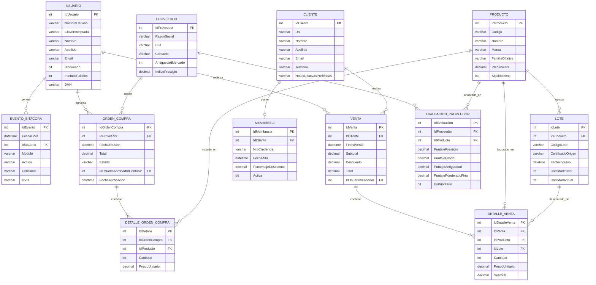

### 8.2 Integridad y Normalizacion
- **Tercera Forma Normal (3FN):** Todas las tablas poseen claves primarias atomicas y atributos no clave con dependencia funcional directa y exclusiva de la PK.
- **Trazabilidad:** Cada venta descuenta de un registro exacto en `LOTE`, vinculando la salida con su `LOTE.CertificadoOrigen` e `IdProducto`.
- **Auditoria e Integridad:** Los eventos de `EVENTO_BITACORA` y registros criticos en `USUARIO` cuentan con campos `DVH` para la validacion horizontal mediante algoritmos hash, complementados por la tabla global `DVV`.
