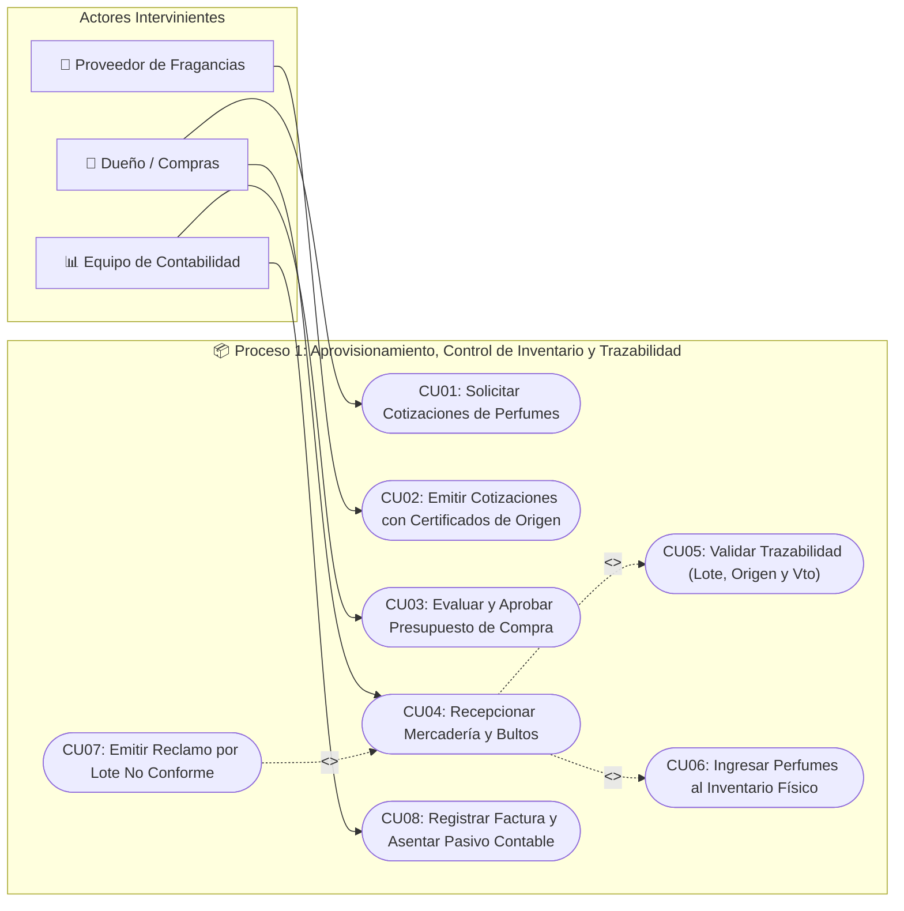
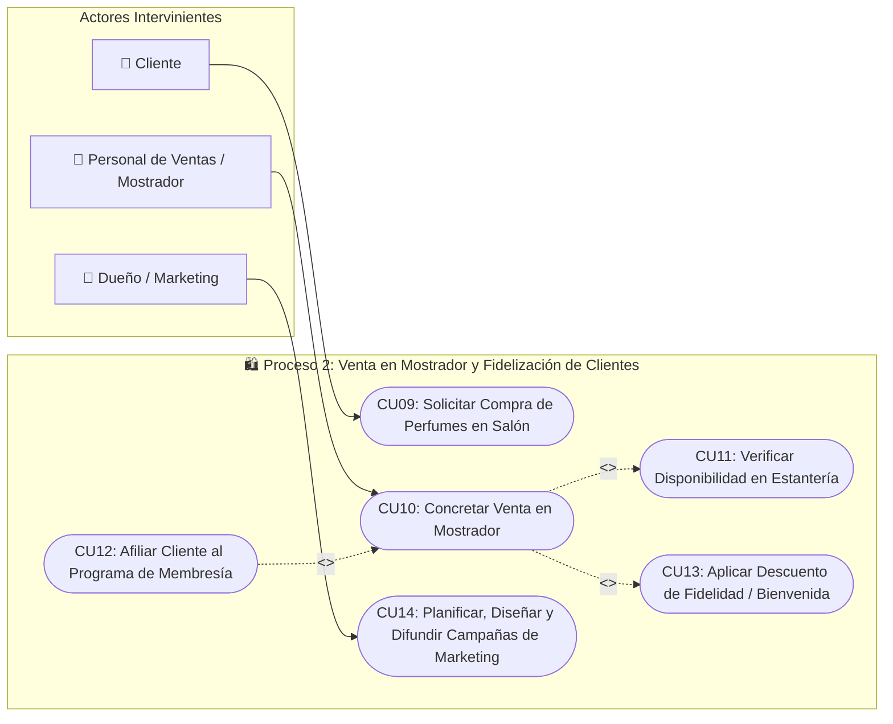
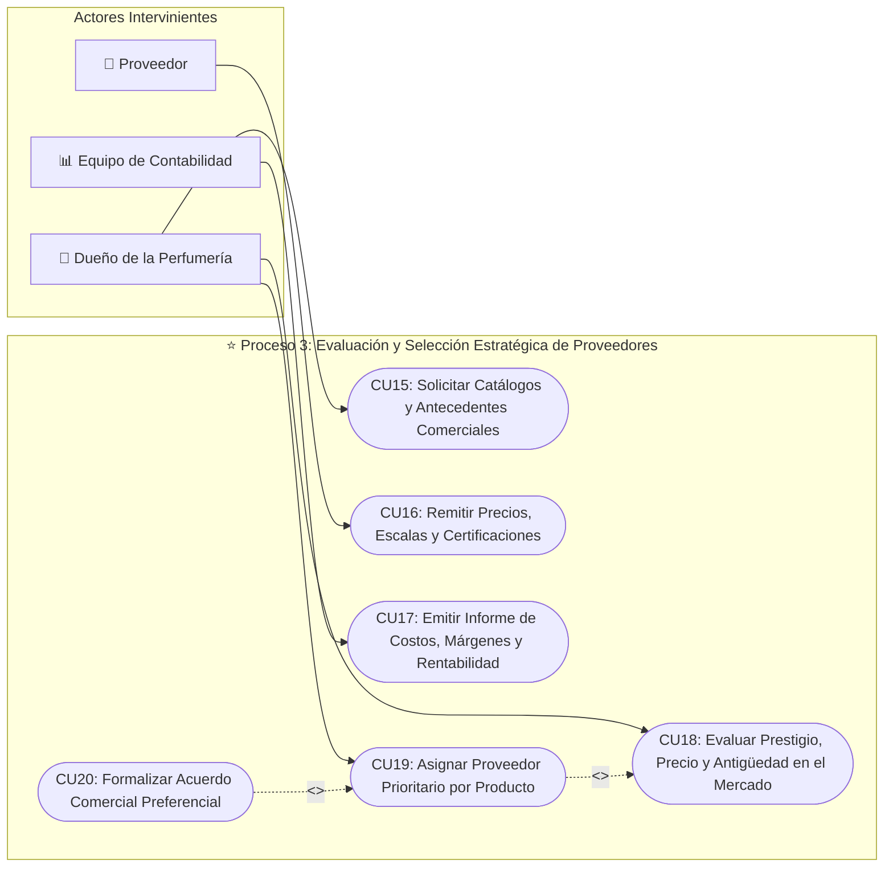
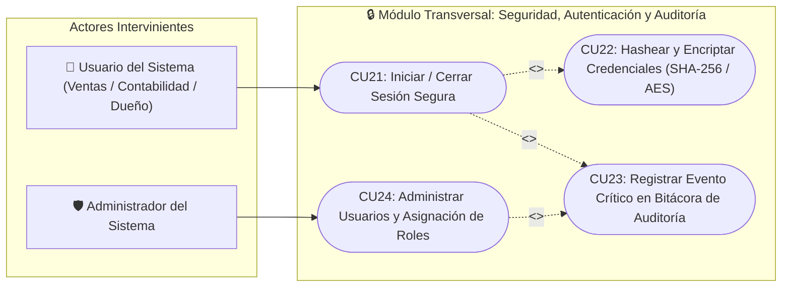
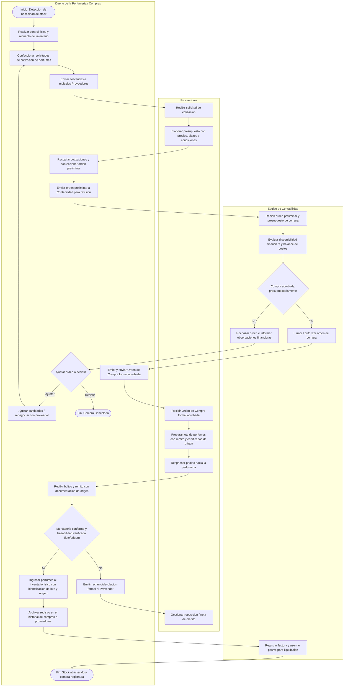
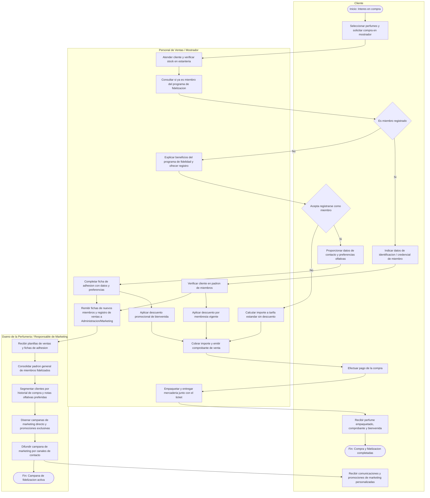
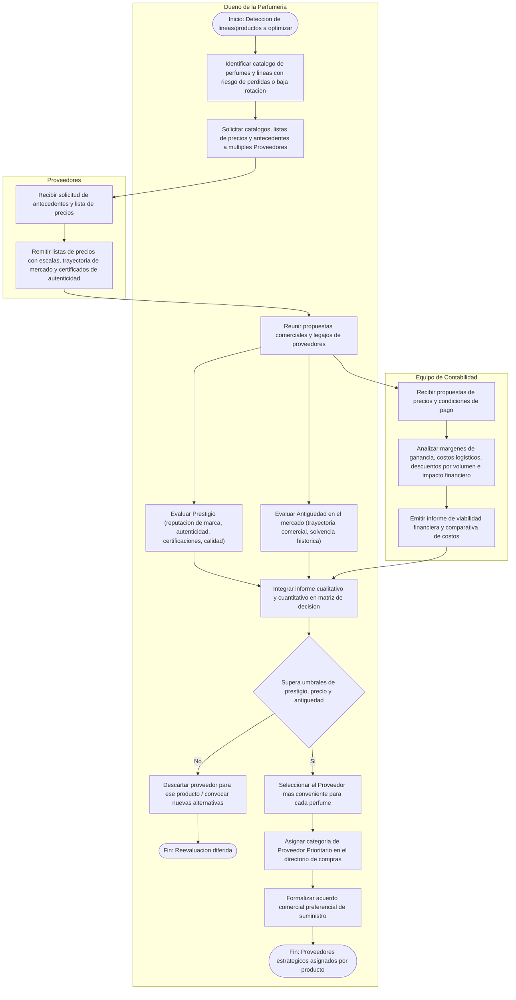
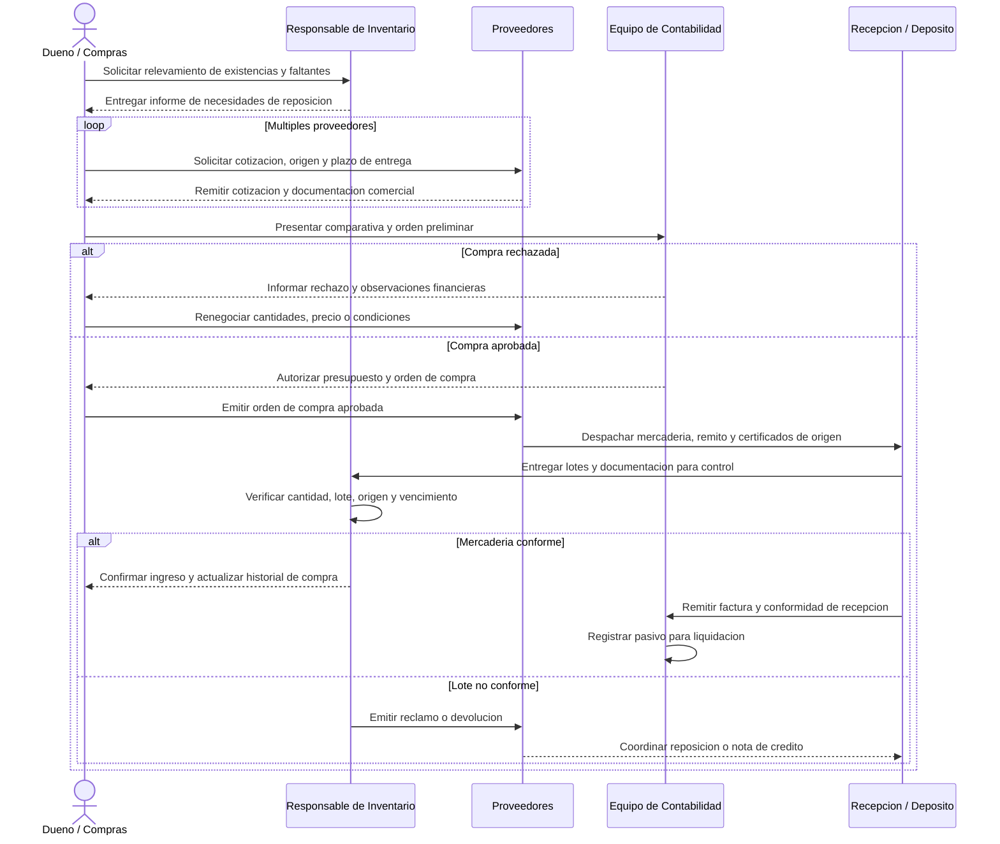
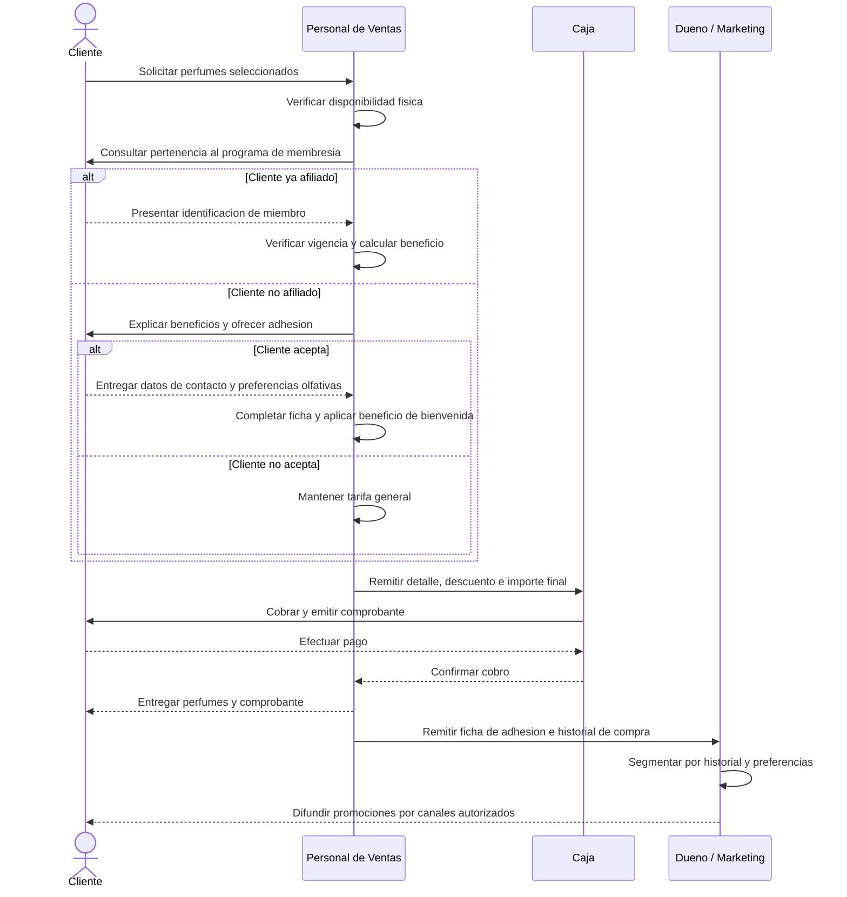
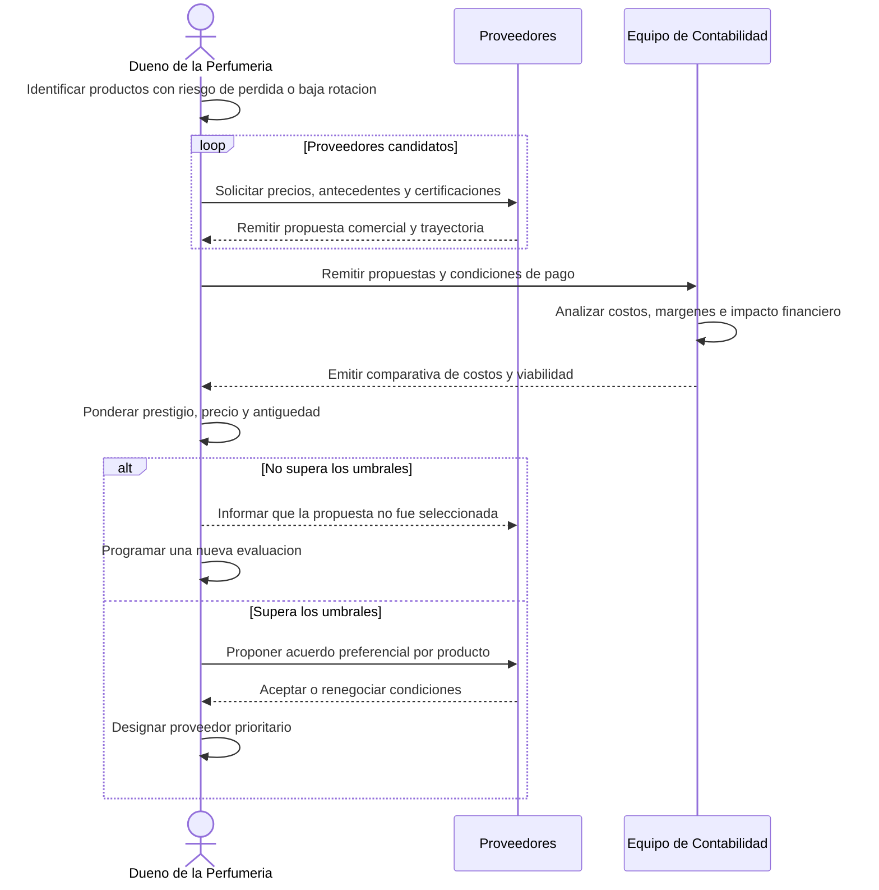

# Modelado de Procesos de Negocio - Perfumeria

## 1. Contexto y Alcance

- **Contexto:** Negocio de perfumeria.
- **Alcance:** Desde la gestion de stock y aprovisionamiento hasta el motor de recomendaciones y fidelizacion de clientes.
- **Enfoque:** Procesos de negocio a nivel estrictamente organizacional (actividades humanas, decisiones y flujo documental entre los roles, sin involucrar componentes de software ni implementaciones tecnicas).
- **Actores del Negocio:**
  - **Dueno de la Perfumeria (o Responsable de Compras/Administracion):** Gestiona compras estrategicas, evaluacion de proveedores y supervision comercial.
  - **Personal de Ventas / Mostrador:** Atiende al publico, consulta y afilia miembros al programa de fidelizacion y concreta cobros.
  - **Equipo de Contabilidad:** Revisa, aprueba financieramente las compras a proveedores y analiza el impacto de costos y rentabilidad.
  - **Proveedores:** Cotizan fragancias, despachan lotes con certificados de origen/remito y remiten antecedentes de mercado.
  - **Clientes:** Compran productos en salon, acceden a membresias de fidelizacion y reciben beneficios y campanas promocionales.

---

## 2. Diagramas de Casos de Uso por Proceso de Negocio

A continuación se presentan los **Diagramas de Casos de Uso divididos individualmente por Proceso de Negocio**, delimitando con precisión sus actores participantes, límites funcionales y relaciones formales de inclusión (`<<include>>`) y extensión (`<<extend>>`).

---

### 2.1 Proceso 1: Aprovisionamiento, Control de Inventario y Trazabilidad

> **Propósito:** Gestionar el abastecimiento de fragancias garantizando el control físico de stock, la trazabilidad de origen de cada lote, la previa aprobación financiera por Contabilidad y el registro de pasivos.

---

### 2.2 Proceso 2: Venta en Mostrador y Fidelización de Clientes

> **Propósito:** Concretar ventas en mostrador incentivando la adhesión a membresías, aplicando descuentos y utilizando las preferencias para campañas de marketing.

---

### 2.3 Proceso 3: Evaluación y Selección Estratégica de Proveedores

> **Propósito:** Calificar y categorizar formalmente a los proveedores según prestigio, precio y antigüedad, asignando proveedores estratégicos por producto para maximizar rentabilidad.

---

### 2.4 Módulo Transversal: Seguridad, Autenticación y Auditoría

> **Propósito:** Proveer autenticación segura, control de acceso basado en roles, cifrado criptográfico y registro de eventos críticos en bitácora.

---

## 3. Diagramas de Actividad de los Procesos de Negocio

---

### Proceso 1: Aprovisionamiento de Perfumes, Control de Inventario, Trazabilidad y Aprobacion Contable

> **Proposito:** Abastecer a la perfumeria consultando a multiples proveedores, garantizando el control fisico de stock, la trazabilidad de origen de cada lote de fragancias, la previa aprobacion financiera por el equipo contable y el resguardo del historial de compras.

---

### Proceso 2: Venta y Fidelizacion de Clientes (Membresia, Descuentos y Campanas)

> **Proposito:** Concretar la venta de fragancias promoviendo la afiliacion del cliente al programa de membresia de la perfumeria, aplicando beneficios/descuentos inmediatos y utilizando los datos y preferencias registradas para la planificacion y ejecucion de campanas de marketing.

---

### Proceso 3: Valor Agregado - Evaluacion y Seleccion Estrategica de Proveedores por Producto

> **Proposito:** Evaluar y clasificar formalmente a los proveedores en funcion de **Prestigio**, **Precio** y **Antiguedad en el mercado**, asignando proveedores preferenciales por perfume o linea de productos para evitar perdidas y maximizar la rentabilidad del negocio.

---

## 4. Diagramas de Secuencia de Negocio

Los participantes representan personas, areas y terceros de la organizacion. Los diagramas describen el intercambio de documentos, decisiones y mercaderia sin introducir componentes del sistema.

### 4.1 Aprovisionamiento, aprobacion contable y trazabilidad

### 4.2 Venta y fidelizacion de clientes

### 4.3 Evaluacion estrategica de proveedores

---

## 5. Correspondencia con el plan y la implementacion

La correspondencia se documenta fuera de los diagramas para mantenerlos centrados en el negocio.

| Codigo del plan | Proceso | Iteracion |
| :--- | :--- | :--- |
| N01 | Aprovisionamiento, aprobacion contable, inventario y trazabilidad | Diseno en Iteracion 1; implementacion en Iteracion 2 |
| N02 | Venta en mostrador y fidelizacion | Diseno e implementacion en Iteracion 2 |
| N03 | Evaluacion y recomendacion de proveedores | Implementacion planificada para Iteracion 3 |

| Actividad organizacional | Operacion de negocio implementada |
| :--- | :--- |
| Registrar propuestas de multiples proveedores | `AprovisionamientoBLL.RegistrarCotizacion` |
| Confeccionar una orden preliminar | `AprovisionamientoBLL.CrearOrdenPreliminar` |
| Presentar la comparativa a Contabilidad | `AprovisionamientoBLL.EnviarOrdenARevisionContable` |
| Autorizar o rechazar la compra | `AprovisionamientoBLL.AprobarOrdenCompra` / `RechazarOrdenCompra` |
| Emitir la orden aprobada al proveedor | `AprovisionamientoBLL.EmitirOrdenAprobada` |
| Recepcionar mercaderia con origen y lote | `AprovisionamientoBLL.RecepcionarMercaderia` |
| Consultar stock y trazabilidad | `InventarioBLL.VerificarStock` / `ObtenerTrazabilidad` |
| Consultar compras por proveedor | `AprovisionamientoBLL.ConsultarHistorialCompras` |
| Registrar cliente, preferencias y consentimiento | `VentaBLL.RegistrarCliente` |
| Incorporar al cliente al programa de fidelidad | `VentaBLL.ActivarMembresia` |
| Registrar la venta y aplicar el descuento | `VentaBLL.RegistrarVenta` |
| Reservar existencias por vencimiento mas proximo | `VentaBLL.RegistrarVenta` y `IVentaRepository.GuardarVenta` |
| Evaluar y recomendar proveedores | N03: pendiente de la Iteracion 3 |

---

## 6. Resumen de Reglas de Negocio Organizacionales

| Proceso de Negocio | Actores Clave (Minimo 3 Swimlanes) | Regla / Politica Organizacional |
| :--- | :--- | :--- |
| **1. Aprovisionamiento y Trazabilidad** | 1. Dueno / Compras 2. Proveedores 3. Equipo de Contabilidad | Toda compra requiere cotizaciones comparativas y autorizacion previa de Contabilidad. Es obligatorio verificar y registrar el lote y origen de cada producto al recepcionarlo fisicamente. |
| **2. Fidelizacion de Clientes** | 1. Cliente 2. Personal de Ventas 3. Dueno / Marketing | En cada venta en mostrador se ofrece membresia. El alta otorga descuentos inmediatos y alimenta la base de datos para la segmentacion y ejecucion de campanas de marketing. |
| **3. Valor Agregado (Seleccion de Proveedores)** | 1. Dueno de la Perfumeria 2. Proveedores 3. Equipo de Contabilidad | La eleccion del proveedor optimo por producto combina **prestigio**, **antiguedad** y **analisis financiero de costos/margenes** para mitigar perdidas y maximizar la rentabilidad. |
