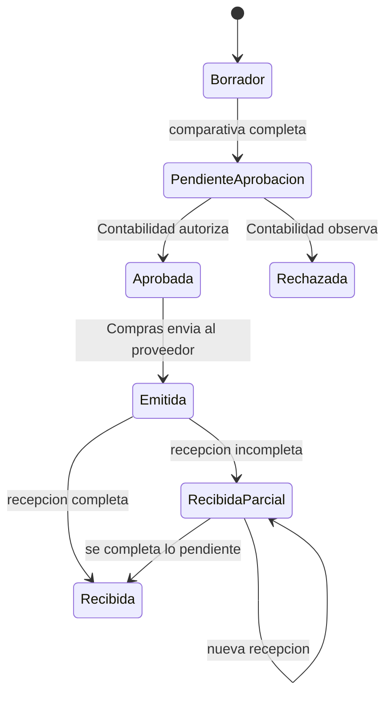

# Implementacion de las iteraciones 1 y 2

## Reconciliacion con el plan de entregas

Este alcance sigue la hoja `Plan de entregas TD 2026` del archivo provisto:

- **Iteracion 1:** G01 a G08 y analisis/diseno de **N01**.
- **Iteracion 2:** implementacion de **N01**, analisis/diseno/implementacion de **N02** e instalador inicial **A01**.
- **Iteracion 3:** **N03**, instalador final y restantes entregables. El motor de recomendacion de proveedores pertenece a esta iteracion y no se presenta como implementado en la segunda.

| Codigo | Proceso del dominio | Estado al cierre de Iteracion 2 |
| :--- | :--- | :--- |
| N01 | Aprovisionamiento, aprobacion contable, inventario y trazabilidad | Analizado, disenado e implementado |
| N02 | Venta en mostrador y fidelizacion | Analizado, disenado e implementado |
| N03 | Evaluacion y recomendacion de proveedores | Analizado de forma preliminar; implementacion reservada para Iteracion 3 |
| A01 | Instalador inicial | Fuente Inno Setup y automatizacion de base preparadas |

## Iteracion 1

La documentacion cubre el proposito, alcance, participantes, definiciones, requisitos generales, diagramas de clases por capa y modelo de datos solicitados en G01-G08. Para N01 se incluyen roles, descripcion funcional, actividad organizacional, modelo conceptual, casos de uso principales, clases, secuencias y datos.

Los diagramas de secuencia describen intercambios entre personas y areas del negocio; deliberadamente no incorporan un actor llamado "Sistema". La correspondencia con el codigo se presenta en una tabla separada.

## Iteracion 2: N01 - Aprovisionamiento e inventario

Se implementaron:

- alta y consulta de proveedores y productos;
- cotizaciones vigentes de multiples proveedores;
- orden preliminar y comparativa minima de dos proveedores por producto;
- aprobacion o rechazo obligatorio por Contabilidad;
- emision de la orden aprobada;
- recepcion total o parcial por lote;
- trazabilidad de producto, proveedor, orden, origen, certificado y vencimiento;
- movimientos de inventario e historial de compras por proveedor;
- auditoria de operaciones criticas mediante la bitacora existente.
- interfaz operativa `UC_Aprovisionamiento` con vistas separadas por actor para Dueño, Contabilidad y Recepción.
- permisos de negocio aplicados tanto en la navegación como en la BLL: `Aprovisionamiento_Gestion`, `Contabilidad_AprobarCompras`, `Inventario_Recepcionar` y `Ventas_Registrar`.

### Estados y reglas de N01



1. La orden debe contener un proveedor activo y al menos un producto activo.
2. Cantidades y precios unitarios deben ser positivos.
3. Antes de la revision contable, cada producto debe tener al menos dos cotizaciones vigentes de proveedores distintos.
4. Solo Contabilidad puede decidir sobre una orden pendiente; el rechazo exige motivo.
5. Solo una orden aprobada puede emitirse.
6. Solo una orden emitida o parcialmente recibida admite recepciones.
7. El lote exige codigo, proveedor, origen, certificado, cantidad positiva y vencimiento futuro cuando corresponda.
8. Lo recibido no puede superar lo ordenado.
9. Lote, existencias, movimiento y estado se actualizan en una misma transaccion.

## Iteracion 2: N02 - Venta y fidelizacion

Se implementaron:

- registro y consulta de clientes con correo unico;
- consentimiento de marketing y preferencias olfativas;
- membresia opcional con porcentaje de descuento controlado;
- venta a cliente identificado o consumidor final;
- calculo de subtotal, descuento y total;
- validacion de productos activos y stock suficiente;
- egreso de lotes por FEFO, priorizando el vencimiento mas proximo;
- descuento de stock condicionado para impedir cantidades negativas;
- persistencia atomica de cabecera, detalle y movimientos de inventario;
- pantalla de ventas y fidelizacion accesible desde el formulario principal.

La segmentacion y el registro de preferencias quedan disponibles para campanas. El envio efectivo de comunicaciones no forma parte de N02.

## Componentes por capa

| Capa | N01 | N02 |
| :--- | :--- | :--- |
| BE | `Proveedor`, `Producto`, `CotizacionProveedor`, `OrdenCompra`, `DetalleOrdenCompra`, `Lote`, `MovimientoStock` | `Cliente`, `Membresia`, `Venta`, `DetalleVenta` |
| BLL | `ProveedorBLL`, `ProductoBLL`, `AprovisionamientoBLL`, `InventarioBLL` | `VentaBLL` |
| DAL | `ProveedorDAL`, `ProductoDAL`, `AprovisionamientoDAL`, `InventarioDAL` | `VentaDAL` |
| MPP | mapeadores de proveedores, productos, ordenes y lotes | `VentaMPP` |
| UI | `UC_Aprovisionamiento`, con pestañas habilitadas según actor | `UC_Ventas` |
| SQL | `SQL/Iteracion2_Aprovisionamiento.sql` | `SQL/Iteracion2_Ventas_Fidelizacion.sql` |

## A01 - Instalador inicial

`Installer/Perfumeria.iss` instala los binarios Release, crea accesos directos y solicita la instancia SQL. Antes de copiar la aplicación, `Installer/VerificarPrerrequisitos.ps1` comprueba .NET Framework 4.7.2 o superior y exige una instancia SQL Server 16.x (SQL Server 2022). Si falta .NET, lo descarga desde Microsoft, valida la firma digital y lo instala silenciosamente; si falta SQL Server, facilita la descarga oficial de SQL Server 2022 Express.

`Installer/InicializarBaseDatos.ps1` restaura la base inicial si no existe, ejecuta las migraciones N01/N02 en la base elegida y actualiza la cadena `MiConexionDB`. El ejecutable fue compilado con Inno Setup 6 en `Installer/Output/Perfumeria_Setup_Iteracion2.exe`.

## Verificacion

```powershell
dotnet msbuild "Trabajo Practico Final.sln" /t:Build /p:Configuration=Release /m
dotnet test "Arquitectura.Tests\Arquitectura.Tests.csproj" --configuration Release --no-restore
```

Las 17 pruebas funcionales y arquitectónicas pasan.

También se ejecutó `Scripts/UiBusinessFlowProbe.cs` como recorrido E2E sobre los controles WinForms reales y la base local `Trabajo Practico Final 3`, usando tres actores:

1. El Dueño registró dos proveedores, un perfume, dos cotizaciones, creó la orden y la envió a revisión.
2. Contabilidad visualizó únicamente su pestaña y aprobó la orden.
3. El Dueño emitió la orden, recibió un lote con origen y certificado, y generó stock.
4. Ventas registró al cliente, creó su membresía y realizó una venta con 10% de descuento.
5. La verificación persistida confirmó orden recibida, aprobador contable, lote con stock residual, cliente, membresía, venta, descuento y movimiento de inventario.
6. Se verificó la denegación de una operación de Compras intentada desde el perfil Contabilidad.
