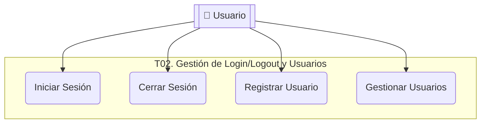

# T02. Gestión de Login/Logout y Usuarios

## Diagrama de Caso de Uso

## Especificaciones de Casos de Uso

### UC-T02-01: Iniciar Sesión

| Nombre del Caso de Uso | **Iniciar Sesión** |
| :--- | :--- |
| **Código** | UC-T02-01 |
| **Objetivo** | Permitir al usuario acceder al sistema validando su identidad. |
| **Precondiciones** | El usuario debe estar registrado y activo en el sistema. |
| **Poscondiciones** | Sesión iniciada y acceso otorgado al menú principal. |
| **Eventos Disparadores** | El usuario abre la aplicación o solicita acceso desde la pantalla de login. |
| **Flujo Normal** | 1. El usuario ingresa email y contraseña. 2. El sistema valida el formato del email. 3. El sistema verifica las credenciales comparando el hash de la contraseña. 4. El sistema registra el evento de inicio de sesión exitoso en la Bitácora. 5. El sistema redirige al usuario al FormPrincipal. |
| **Excepciones** | **E1: Email Inválido:** El sistema informa que el formato de email es incorrecto. **E2: Credenciales Incorrectas:** El sistema informa el error, suma un intento fallido y registra el evento en Bitácora. **E3: Usuario Bloqueado:** Si el usuario alcanza 5 intentos fallidos, el sistema bloquea la cuenta e informa al usuario. |

### UC-T02-02: Cerrar Sesión

| Nombre del Caso de Uso | **Cerrar Sesión** |
| :--- | :--- |
| **Código** | UC-T02-02 |
| **Objetivo** | Finalizar la sesión actual del usuario de forma segura. |
| **Precondiciones** | Debe existir una sesión activa. |
| **Poscondiciones** | Sesión cerrada, recursos liberados y retorno a la pantalla de login. |
| **Eventos Disparadores** | El usuario selecciona la opción "Cerrar Sesión" en el menú. |
| **Flujo Normal** | 1. El usuario solicita cerrar sesión. 2. El sistema solicita confirmación mediante un diálogo. 3. El sistema invalida el token de sesión y libera los recursos en memoria. 4. El sistema registra el evento de cierre de sesión en la Bitácora. 5. El sistema redirige al usuario al formulario de Login. |
| **Excepciones** | **E1: Cancelación:** El usuario opta por no cerrar sesión, el sistema mantiene la interfaz actual. |
