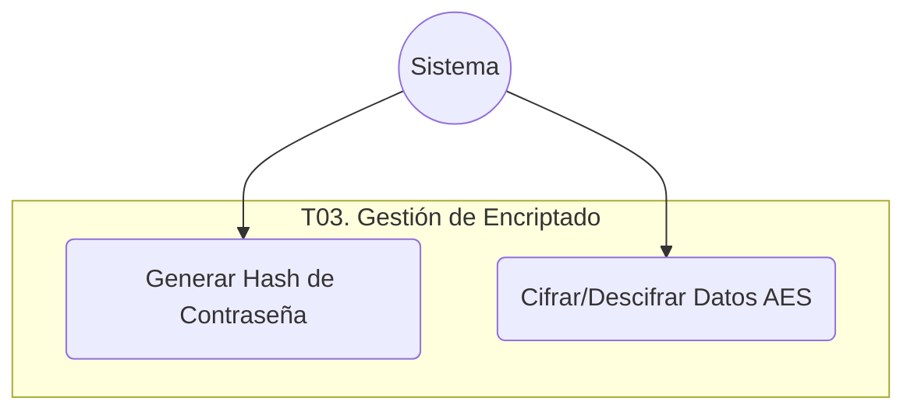

# T03. Gestión de Encriptado

## Diagrama de Caso de Uso

## Especificaciones de Casos de Uso

### UC-T03-01: Generar Hash de Contraseña

| Nombre del Caso de Uso | **Generar Hash de Contraseña** |
| :--- | :--- |
| **Código** | UC-T03-01 |
| **Objetivo** | Transformar una contraseña en texto plano en un hash irreversible para su almacenamiento seguro. |
| **Precondiciones** | Provisión de una cadena de texto (contraseña). |
| **Poscondiciones** | Generación de una cadena hash (SHA256). |
| **Eventos Disparadores** | Registro de nuevo usuario o cambio de contraseña. |
| **Flujo Normal** | 1. El sistema recibe la contraseña en texto plano. 2. El sistema aplica el algoritmo de hashing SHA256. 3. El sistema retorna la cadena resultante para su persistencia. |
| **Excepciones** | **E1: Texto Vacío:** El sistema valida que la entrada no sea nula antes de procesar. |

### UC-T03-02: Cifrar/Descifrar Datos AES

| Nombre del Caso de Uso | **Cifrar/Descifrar Datos AES** |
| :--- | :--- |
| **Código** | UC-T03-02 |
| **Objetivo** | Proteger datos sensibles (como DNI) mediante cifrado simétrico. |
| **Precondiciones** | Dato en texto plano (para cifrar) o cifrado (para descifrar) y clave de cifrado válida. |
| **Poscondiciones** | Dato transformado según la operación solicitada. |
| **Eventos Disparadores** | Lectura o escritura de datos sensibles en la base de datos (Ej: DNI). |
| **Flujo Normal** | 1. El sistema recibe el dato y la operación (Cifrar/Descifrar). 2. El sistema aplica el algoritmo AES utilizando la clave de sistema. 3. El sistema retorna el resultado (texto cifrado o plano). |
| **Excepciones** | **E1: Error de Clave:** Si la clave es inválida o el dato está corrupto, el sistema lanza una excepción técnica. |
