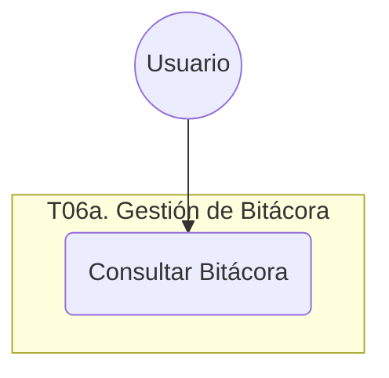

# T06a. Gestión de Bitácora

## Diagrama de Caso de Uso

## Especificaciones de Casos de Uso

### UC-T06a-01: Consultar Bitácora

| Nombre del Caso de Uso | **Consultar Bitácora** |
| :--- | :--- |
| **Código** | UC-T06a-01 |
| **Objetivo** | Permitir la visualización y filtrado de los eventos de auditoría del sistema. |
| **Precondiciones** | El usuario debe estar autenticado. |
| **Poscondiciones** | Los registros de auditoría que coinciden con los filtros son mostrados en pantalla. |
| **Eventos Disparadores** | El usuario selecciona la opción "Ver Bitácora" en el menú. |
| **Flujo Normal** | 1. El usuario accede al User Control de Bitácora. 2. El sistema recupera los últimos eventos registrados. 3. El usuario ingresa criterios de búsqueda (fechas, usuario, actividad). 4. El sistema filtra los registros en la base de datos. 5. El sistema actualiza la grilla con los resultados. |
| **Excepciones** | **E1: Sin Registros:** Si la búsqueda no arroja resultados, el sistema informa que no hay eventos para esos criterios. |
