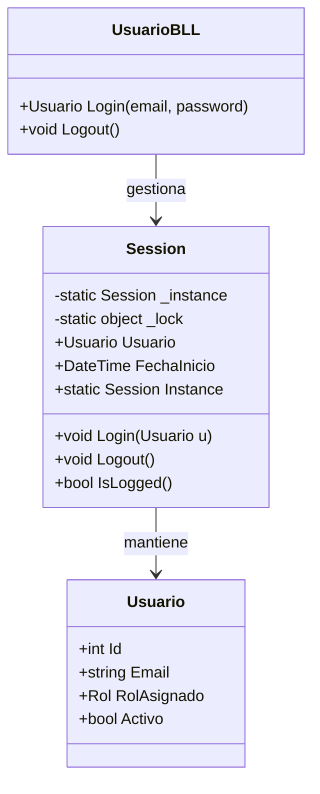
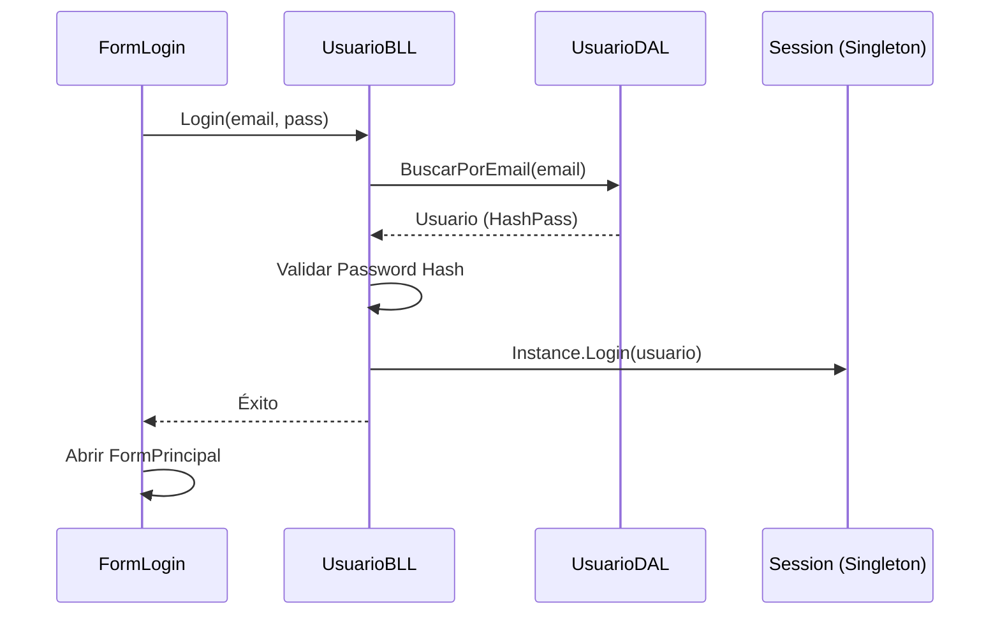

## Objetivo

El objetivo del subsistema T02 es gestionar de manera segura y centralizada el acceso de los usuarios al sistema, manteniendo el estado de la sesión mediante el patrón Singleton y garantizando la trazabilidad de cada fase del ciclo de vida de la aplicación.

## Descripción Detallada

El sistema implementa una arquitectura de 4 capas donde el acceso se controla mediante la validación de credenciales encriptadas.

### 1. Patrón Singleton (Sesión)
Se utiliza la clase `Servicios.Session` para asegurar que solo exista una instancia de la sesión activa en memoria, accesible globalmente pero protegida contra múltiples instanciaciones mediante un bloqueo (`lock`).

### 2. Ciclo de Vida del Sistema

| Fase | Responsable | Acciones |
| :--- | :--- | :--- |
| **Arranque (Startup)** | `UI.Program` | Verifica conectividad a la BD (`IntegrityBLL`), registra evento `STARTUP` en Bitácora. |
| **Log-in** | `BLL.UsuarioBLL` | Valida Email/Pass (Hash), suma intentos fallidos, bloquea cuenta (4 intentos), instancia `Session`. |
| **Sesión Activa** | `Servicios.Session` | Mantiene el objeto `Usuario` y su `Rol` (perfil) disponible para la UI. |
| **Log-out** | `BLL.UsuarioBLL` | Destruye la instancia de `Session`, registra evento `LOGOUT`, retorna al login. |
| **Apagado (Shutdown)** | `UI.FormPrincipal` | Al cerrar el formulario MDI, se asegura el logout y registro de cierre de sistema. |

## Diagramas Mermaid

### Diagrama de Clases (Autenticación)

### Diagrama de Secuencia (Login Exitoso)

## Diseño de Algoritmos

### Algoritmo de Autenticación (UsuarioBLL.Login)
1. **Entrada**: `email`, `passwordSinHash`.
2. **Validar**: Formato de `email` mediante Regex.
3. **Buscar**: Obtener `usuario` de la base de datos por `email`.
4. **Si no existe**: Registrar `LOGIN_FALLIDO`, retornar `null`.
5. **Si bloqueado**: Lanzar `UsuarioBloqueadoException`.
6. **Encriptar**: Generar `hash` de `passwordSinHash`.
7. **Si coincide**:
   - Resetear intentos fallidos en DB.
   - Registrar evento `LOGIN`.
   - Retornar `usuario`.
8. **Si no coincide**:
   - Incrementar intentos en DB.
   - Si intentos >= 4: Registrar `BLOQUEO`, lanzar excepción.
   - Retornar `null`.

## Diseño de Persistencia (DER)
El DER para este subsistema involucra las tablas `USUARIO` y `ROL`, con una relación 1:N donde cada usuario tiene un `rol_id` que define su perfil de acceso.

| Tabla | Campos Clave |
| :--- | :--- |
| **USUARIO** | Id (PK), Email (UK), Password (Hash), Activo (Bit), RolId (FK) |
| **ROL** | Id (PK), Nombre (UK), Descripcion |
