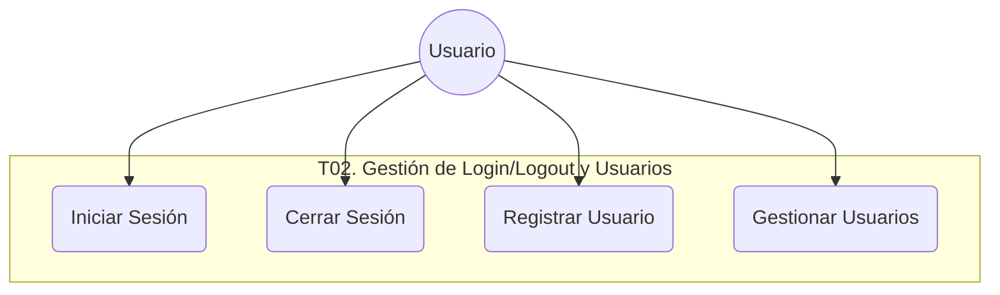
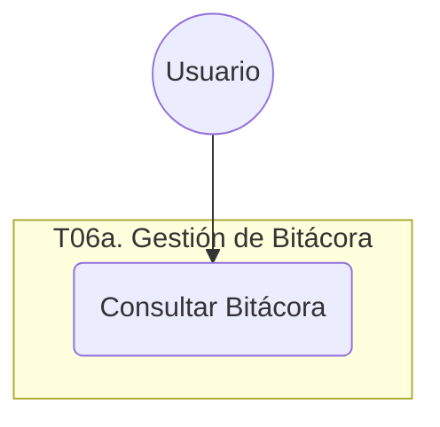
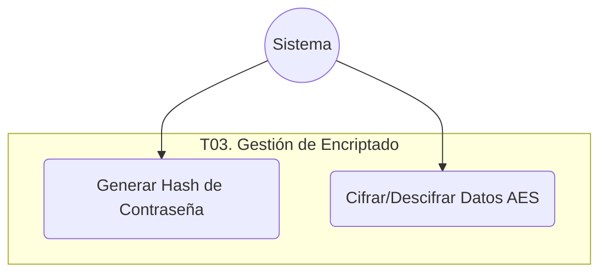

## Context

The system requires structured documentation of its core functionalities to comply with engineering standards. This design defines the use cases for User Management (T02), Encryption (T03), and Audit Logging (T06a), focusing on their visual representation and analytical description.

## Goals / Non-Goals

**Goals:**
- Provide clear use case diagrams for T02, T03, and T06a using Mermaid.
- Document each use case with a detailed description table, including normal and alternative flows.
- Ensure consistency with the project's technical architecture.

**Non-Goals:**
- Documentation of Role Management (T04) or complex permissions.
- Implementation of new features; this is a documentation-only change.

## Decisions

- **Diagram Format**: Mermaid `useCaseDiagram` (or standard `graph TD` if `useCaseDiagram` is not fully supported by the renderer) to maintain diagrams as code.
- **Description Template**: A Markdown table approximating the "Descripcion_Caso_de_Uso.png" and `carpeta_modelo.md` structure.
- **Separation of Concerns**: Each module (T02, T03, T06a) will have its own set of diagrams and descriptions.

## Use Case Documentation

### T02. Gestión de Login/Logout y Usuarios

#### Use Case Diagram

#### Descriptions

| Nombre del Caso de Uso | **Iniciar Sesión** |
| :--- | :--- |
| **Código** | UC-T02-01 |
| **Objetivo** | Permitir al usuario acceder al sistema validando su identidad. |
| **Precondiciones** | El usuario debe estar registrado y activo en el sistema. |
| **Poscondiciones** | Sesión iniciada y acceso otorgado al menú principal. |
| **Eventos Disparadores** | El usuario abre la aplicación o solicita acceso desde la pantalla de login. |
| **Flujo Normal** | 1. El usuario ingresa email y contraseña. 2. El sistema valida el formato del email. 3. El sistema verifica las credenciales comparando el hash de la contraseña. 4. El sistema registra el evento de inicio de sesión exitoso en la Bitácora. 5. El sistema redirige al usuario al FormPrincipal. |
| **Excepciones** | **E1: Email Inválido:** El sistema informa que el formato de email es incorrecto. **E2: Credenciales Incorrectas:** El sistema informa el error, suma un intento fallido y registra el evento en Bitácora. **E3: Usuario Bloqueado:** Si el usuario alcanza 5 intentos fallidos, el sistema bloquea la cuenta e informa al usuario. |

| Nombre del Caso de Uso | **Cerrar Sesión** |
| :--- | :--- |
| **Código** | UC-T02-02 |
| **Objetivo** | Finalizar la sesión actual del usuario de forma segura. |
| **Precondiciones** | Debe existir una sesión activa. |
| **Poscondiciones** | Sesión cerrada, recursos liberados y retorno a la pantalla de login. |
| **Eventos Disparadores** | El usuario selecciona la opción "Cerrar Sesión" en el menú. |
| **Flujo Normal** | 1. El usuario solicita cerrar sesión. 2. El sistema solicita confirmación mediante un diálogo. 3. El sistema invalida el token de sesión y libera los recursos en memoria. 4. El sistema registra el evento de cierre de sesión en la Bitácora. 5. El sistema redirige al usuario al formulario de Login. |
| **Excepciones** | **E1: Cancelación:** El usuario opta por no cerrar sesión, el sistema mantiene la interfaz actual. |

---

### T06a. Gestión de Bitácora

#### Use Case Diagram

#### Descriptions

| Nombre del Caso de Uso | **Consultar Bitácora** |
| :--- | :--- |
| **Código** | UC-T06a-01 |
| **Objetivo** | Permitir la visualización y filtrado de los eventos de auditoría del sistema. |
| **Precondiciones** | El usuario debe estar autenticado. |
| **Poscondiciones** | Los registros de auditoría que coinciden con los filtros son mostrados en pantalla. |
| **Eventos Disparadores** | El usuario selecciona la opción "Ver Bitácora" en el menú. |
| **Flujo Normal** | 1. El usuario accede al User Control de Bitácora. 2. El sistema recupera los últimos eventos registrados. 3. El usuario ingresa criterios de búsqueda (fechas, usuario, actividad). 4. El sistema filtra los registros en la base de datos. 5. El sistema actualiza la grilla con los resultados. |
| **Excepciones** | **E1: Sin Registros:** Si la búsqueda no arroja resultados, el sistema informa que no hay eventos para esos criterios. |

---

### T03. Gestión de Encriptado

#### Use Case Diagram

#### Descriptions

| Nombre del Caso de Uso | **Generar Hash de Contraseña** |
| :--- | :--- |
| **Código** | UC-T03-01 |
| **Objetivo** | Transformar una contraseña en texto plano en un hash irreversible para su almacenamiento seguro. |
| **Precondiciones** | Provisión de una cadena de texto (contraseña). |
| **Poscondiciones** | Generación de una cadena hash (SHA256). |
| **Eventos Disparadores** | Registro de nuevo usuario o cambio de contraseña. |
| **Flujo Normal** | 1. El sistema recibe la contraseña en texto plano. 2. El sistema aplica el algoritmo de hashing SHA256. 3. El sistema retorna la cadena resultante para su persistencia. |
| **Excepciones** | **E1: Texto Vacío:** El sistema valida que la entrada no sea nula antes de procesar. |

| Nombre del Caso de Uso | **Cifrar/Descifrar Datos AES** |
| :--- | :--- |
| **Código** | UC-T03-02 |
| **Objetivo** | Proteger datos sensibles (como DNI) mediante cifrado simétrico. |
| **Precondiciones** | Dato en texto plano (para cifrar) o cifrado (para descifrar) y clave de cifrado válida. |
| **Poscondiciones** | Dato transformado según la operación solicitada. |
| **Eventos Disparadores** | Lectura o escritura de datos sensibles en la base de datos (Ej: DNI). |
| **Flujo Normal** | 1. El sistema recibe el dato y la operación (Cifrar/Descifrar). 2. El sistema aplica el algoritmo AES utilizando la clave de sistema. 3. El sistema retorna el resultado (texto cifrado o plano). |
| **Excepciones** | **E1: Error de Clave:** Si la clave es inválida o el dato está corrupto, el sistema lanza una excepción técnica. |

## Risks / Trade-offs

- **[Risk] Complexity of Diagrams** → **Mitigation**: Use simple Mermaid diagrams focusing on the requested modules without over-complicating with role logic.
- **[Trade-off] Manual Documentation Sync** → **Mitigation**: Use these use cases as the source of truth for further development tasks.
